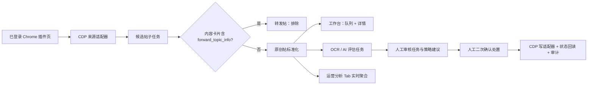
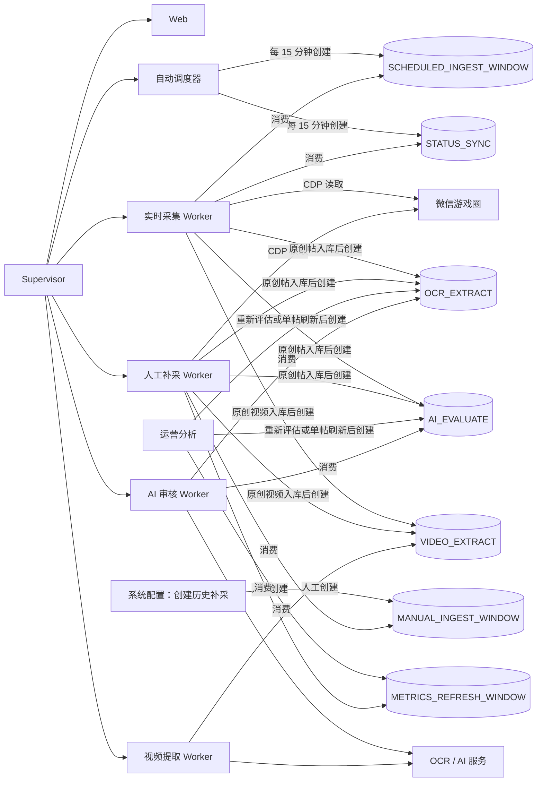

# 系统总览

微信游戏圈内容运营服务是一个 Django + SQLite 单体内部工具。它通过本机已登录 Chrome 的 CDP 读取原平台数据，筛选原创帖子，为运营人员提供“队列 + 详情”的管理工作台，并将 AI 建议、人工处置和运营分析统一留痕。

## 一眼看懂



核心原则：AI 不会自动操作原平台；单帖处置需要运营人员确认并记录原因。批量处置也必须由运营人员在工作台显式触发，且仅限带风险依据的 AI 沉底/屏蔽建议。Cookie、令牌、完整已认证 URL、作者 `openid` 和评论正文均不持久化。

## 模块

| 模块 | 职责 | 主要入口 |
| --- | --- | --- |
| `config` | Django 配置、SQLite 初始化、CDP 会话桥接、敏感日志脱敏。 | `config/settings.py`、`config/cdp.py` |
| `jobs` | 持久化后台任务、幂等键、检查点、重试和按任务类型隔离的 Scheduler/Worker。 | Supervisor 托管的 Scheduler、采集 Worker、AI Worker |
| `posts` | 候选帖采集、原创/转发判定、游戏目录缓存、内容/媒体/投票投影、互动快照和工作台。 | `/`、`posts/services.py`、Admin 游戏目录 |
| `reviews` | OCR、AI 评估、策略建议、人工审核、回复草案本地持久化与上游操作审计。 | `reviews/tasks.py`、工作台审核栏 |
| `reporting` | 北京时间日期范围的只读实时运营分析与工作台页面。 | `/reports/` |

## 运行架构与任务流

日常只启动 Supervisor。它托管一个 Web、一个自动调度器、一个实时采集 Worker、一个人工补采 Worker、一个 AI 审核 Worker 和一个可选视频提取 Worker；各 Worker 职责严格分离。SQLite 部署不允许启动同一 Worker 职责的第二个实例。



### 进程角色

| 进程 | 数量 | 角色 | 不负责的事 |
| --- | ---: | --- | --- |
| 自动调度器（Supervisor 服务 `scheduler`） | 1 | 每 15 分钟创建最近 30 分钟的采集任务和一项最多 20 条待审核帖的状态巡检任务。 | 不连接 CDP、不读取微信、不调用 AI、不消费任务。 |
| 实时采集 Worker（Supervisor 服务 `ingestion`） | 1 | 消费自动采集与状态巡检任务；通过 CDP 读取微信并写入帖子、状态与互动快照；原创帖入库后创建 OCR/AI 任务。 | 不消费人工补采、范围互动刷新或旧采集任务；不调用 AI，不执行上游写处置。 |
| 人工补采 Worker（Supervisor 服务 `backfill_ingestion`） | 1 | 消费人工历史补采、范围互动刷新和旧 `INGEST_WINDOW` 任务；复用相同的 CDP 分页与 checkpoint 逻辑。 | 不消费 Scheduler 创建的实时任务；不调用 AI，不执行上游写处置。 |
| AI 审核 Worker（Supervisor 服务 `review`） | 1 | 串行消费 OCR 与 AI 评估任务，写入 OCR、风险证据、审核建议和本地草案。 | 不创建定时任务，不直接读取微信，不执行上游写处置。 |
| 视频提取 Worker（Supervisor 服务 `video_extraction`） | 1 | 可选地消费 `VIDEO_EXTRACT`，在本机临时目录提取视频时间证据。 | 不使用 CDP Cookie，不保存视频/帧/音频，不向模型传视频 URL 或二维码目标。 |

实时采集与人工补采各自串行处理所属任务。首次补采近几天数据或人工范围互动刷新耗时较长时，自动创建的 15 分钟采集和状态巡检仍由实时采集 Worker 独立处理；AI 审核 Worker 同样独立。调度器的同一时间桶使用幂等键复用任务，避免重复创建。旧 `INGEST_WINDOW` 因无法可靠判断来源，始终由人工补采 Worker 兼容消费。

### 当前后台 Job

| Job 类型 | 生产者 | 消费者 | 作用与边界 |
| --- | --- | --- | --- |
| `SCHEDULED_INGEST_WINDOW` | 自动调度器。 | 实时采集 Worker | 按 AppID、时间窗口和页大小断点拉取候选帖，判定原创/转发并保存帖子、媒体、投票和互动数据。每页更新 checkpoint。 |
| `STATUS_SYNC` | 自动调度器。 | 实时采集 Worker | 每 15 分钟回读最多 20 条最久未更新的待审核原创帖，只更新上游状态和互动快照，不修改本地审核结论。 |
| `MANUAL_INGEST_WINDOW` | 系统配置首页“创建历史补采”。 | 人工补采 Worker | 按选定可管理游戏和最近小时数断点拉取候选帖；不会阻塞自动采集。`enqueue_ingestion` 仅用于诊断。 |
| `METRICS_REFRESH_WINDOW` | 运营分析页“刷新本范围数据”。 | 人工补采 Worker | 仅按当前时间范围内已入库原创帖的 `topic_id` 回读浏览、点赞、评论和分享；不采集转发帖，不更新正文或状态。 |
| `INGEST_WINDOW` | 升级前历史存量。 | 人工补采 Worker | 兼容旧采集窗口及其已有 checkpoint；新代码不再创建此类型。 |
| `OCR_EXTRACT` | 原创帖采集完成、单帖刷新、人工重新评估或诊断命令。 | AI 审核 Worker | 提取原创帖图片文字，供后续 AI 评估使用。 |
| `AI_EVALUATE` | 与 `OCR_EXTRACT` 成对创建。 | AI 审核 Worker | 基于正文、投票和 OCR 输出分类、风险依据、置信度与人工审核建议；不自动执行处置。 |
| `VIDEO_EXTRACT` | 启用视频审核后，原创帖的视频媒体。 | 视频提取 Worker | 受限 HTTPS 本地读取、抽帧二维码检测/OCR 和可选 ASR；失败不阻塞 AI，但要求人工重点核验。 |

## 系统配置与追溯台

`/admin/` 是“系统配置与追溯台”，不是第二个内容管理入口。顶部可在内容管理、运营分析和系统配置之间切换；首页 Hero 下方的“初始化与运行状态”Pipeline 优先展示 Supervisor、默认策略、AI/OCR、CDP 和三个业务节点的就绪状态与下一步。其中帖子采集 Worker 节点同时管理实时采集和人工补采两个进程，并提供各自日志入口。

- 可编辑配置包括审核策略版本、审核策略规则，以及 Pipeline 中白名单 AI/OCR 配置和人工处置开关。密钥只可写入、不会回显；AI/OCR 变更重启 AI Worker，处置开关变更重启 Web。策略规则用于维护风险标签、最低置信度、优先级和建议动作；首页默认折叠当前启用策略的规则摘要，展开后可查看中文风险类型、阈值、建议动作和优先级。规则编辑列表同时保留风险编码与中文释义。
- Supervisor 启动预检会幂等初始化“通用内容审核策略”。它包含通用违规、无关内容、负面灌水、交易风险和内容异常的基线规则；预检不覆盖已有规则，且只会在没有启用策略时启用该默认版本。`ensure_default_policy` 仅用于诊断或恢复。
- 帖子采集 Worker 节点提供“创建历史补采”弹窗：从本地可管理游戏目录选择游戏，默认城主别慌张，输入最近 1 至 744 小时。它只创建 `MANUAL_INGEST_WINDOW`，不会在页面请求中连接 CDP；人工补采 Worker 未运行时任务保持待执行。
- 可管理游戏目录不能手工新增、修改或删除；只能通过“从受控微信同步可管理游戏”读取当前受控 Chrome 会话中的授权游戏。同步失败会保留本地目录。
- 候选帖子、原创帖子、媒体、互动快照、OCR、AI 评估、风险证据、审核任务、回复草案、操作审计和后台任务均为只读追溯数据，可搜索、筛选和查看关联详情。
- 对帖子或审核任务，配置台提供“在内容管理中查看”链接。沉底、屏蔽、禁言、恢复和批量处置只允许从内容管理工作台发起；历史 Admin 处置地址会明确返回不可用，且不会写入审计。

## 表结构

数据库文件默认位于 `runtime/operations.sqlite3`。`runtime/` 统一保存部署配置、数据库、收集后的静态文件、Worker 锁和可选运行日志；该目录不纳入代码包。完整字段、枚举、关系和约束见[数据库数据字典](../technical/database-schema.md)。

## 数据与判定

### 原创帖

候选列表不直接决定帖子类型。系统会对每条候选调用内容卡片详情：`forward_topic_info` 字段存在且值不为 `null` 即标记为转发帖；该候选记录仅保留最小判定信息供统计，不进入工作台或原创报表。字段缺失或值为 `null` 时才作为原创帖保存。

原创帖保存正文、图片/视频引用、互动快照与投票文本。投票只保存标题和全部选项文本，保持原始顺序，以识别藏头或拆字形式的引流信息；不保存投票项 ID、投票状态或投票者信息。

### 业务删除

管理详情返回已验证的业务错误码 `-10075007` 时，系统为 `status` 添加本地删除位 `128`。删除位可与屏蔽 `4`、沉底 `8` 组合，正常仅为基值 `2`，不参与按位组合。该状态仍会显示在工作台、搜索和原创统计中，供历史追溯；不可执行任何上游处置，但可以重新评估以更新本地风险证据。若内容卡片仍可读，刷新会只读补齐历史正文、媒体和投票，不会清除删除位；只有后续管理详情重新成功才会以原平台状态覆盖该值并恢复可运营性。

### 互动与评论

浏览、点赞、回复和分享数以时间快照保存。详情接口中的评论列表和作者信息会被丢弃，不保存评论正文。

## 工作台交互

访问 `/` 登录后进入工作台：

1. 内容管理标题旁为单选游戏上下文；未提供或无效 AppID 时默认“城主别慌张”，不提供全部游戏或多选范围。左侧原创帖子队列仅在当前游戏内支持正文、投票文本、类别、风险、建议动作、审核状态和优先级排序筛选；除游戏外的多选维度按 OR 匹配，未选择任何值即不过滤该维度。快速筛选“待处理推荐”预选沉底、屏蔽、禁言、人工判断、待审核和正常状态。
2. 中间主阅读区展示正文、投票内容、图片/视频附件与最新互动指标。
3. 详情顶部横向展示 AI 评估状态、重新评估、内容分类、置信度、审核优先级和策略建议；风险依据默认折叠，展开后在原位置显示证据与模型/策略版本。存在本地回复草案的反馈或建议帖会在风险依据后显示可折叠“回复建议”，可编辑、复制或标记本地已采纳。
4. 右侧为随页面滚动保持可见的悬浮处置卡。AI 建议只在对应操作上显示 `AI 推荐` 角标，不会自动操作原平台；回复建议同样仅保存在本系统，绝不调用原平台发布或评论接口。
5. 使用上一条、下一条或 `J`、`K`、左右方向键在当前筛选结果中切换帖子；点击图片或视频在页内模态框预览，预览中可用左右方向键切换附件。
6. “刷新数据”会回读管理详情、内容卡片、媒体、投票和可用互动指标。处置卡展示状态：`2` 正常、`4` 屏蔽、`8` 沉底、`16` 仅自己可见、`128` 原平台已删除；删除可与屏蔽、沉底组合且会禁用全部审核处置。仅自己可见可保留本地审核记录，但不会触发任何上游处置，避免覆盖未验证的原平台可见性状态。
7. 顶部账户名左侧的 `CDP` 状态胶囊会异步显示受控 Chrome 登录态。绿灯不可点击；红灯可由已登录运营人员点击，但服务端只会通过 CDP 在受控 Chrome 打开固定、未认证的插件登录页，不接受前端传入 URL，也不会在当前工作台浏览器打开登录页。

游戏选择器读取本地缓存目录。管理员可在系统配置与追溯台的“可管理游戏”中选择“从受控微信同步可管理游戏”刷新名称；同步需要已登录的受控公众平台页面，失败时保留上次缓存且不影响工作台。

## 审核与处置

AI 评估会输出内容类别、风险证据、置信度与建议动作，但所有结果都进入人工审核。工作台不提供人工标签或 AI 正误反馈；对已有回复草案的帖子，运营人员可在详情内编辑、复制和标记本地已采纳。采纳不代表已回复用户，系统不会自动或手动通过该入口发布到原平台。

工作台支持以下人工动作：跳过、沉底、屏蔽、禁言、解除禁言、恢复正常。

- 跳过只完成本地人工审核，不发送上游请求。
- 屏蔽和禁言要求选择已验证的违规原因；禁言还要求选择 1/3/7/30 天期限。
- 解除禁言会先确认当前游戏仍处于禁言，再读取目标身份标识并即时发送请求；身份标识不写入数据库或审计。
- 每次上游操作均创建审计记录，使用“帖子 + 动作 + 本次确认令牌”去重，并读取前后状态验证结果；跳过也会记录人工最终动作和业务原因。
- 操作失败、会话失效、响应结构变化或状态不一致均记录为 `ACTION_FAILED`，不会自动重试。

工作台还提供人工触发的批量执行入口：只从当前队列取最多 20 条同时满足“原创、状态正常、待审核、AI 建议为沉底或屏蔽、存在风险依据”的帖子。每条都会独立回读上游状态、写入审计并完成本地审核；任一条失败不会中断其他帖子。批量屏蔽固定使用上游违规原因“其他”（`1`），沉底与屏蔽的业务原因均由可读的 AI 风险依据摘要生成。禁言、人工判断、屏蔽并禁言和无风险依据的建议不会进入批量操作。

真实上游写入需同时启用 `ENABLE_UPSTREAM_WRITES=true` 与对应的单项开关。所有单项开关默认关闭；开启仅允许人工确认路径使用，AI、scheduler 和 worker 不可调用写适配器。

## 日常运行

### 采集

1. 启动带远程调试端口 `9222` 的 Chrome，并在受控微信插件页完成登录。
2. 对城主别慌张，Supervisor 托管的 Scheduler 按北京时间每 15 分钟创建最近 30 分钟的采集任务。超过 30 分钟的历史补采在系统配置首页“帖子采集 Worker”创建指定游戏和最近小时数的任务；`enqueue_ingestion` 仅用于诊断。
3. Supervisor 托管的实时采集 Worker 拉取 Scheduler 创建的帖子；人工补采 Worker 拉取人工窗口与运营分析互动刷新任务。两者均按页保存 checkpoint，中断后可恢复。
4. Supervisor 托管的 AI Worker 消费 OCR 与 AI 审核任务；它不会认领帖子拉取任务。
5. 调度器每 15 分钟还会创建一项待审核帖子状态巡检；实时采集 Worker 每次最多回读 20 条最久未更新的待审核帖，只更新上游状态和互动数据，不改变本地审核状态。
6. 在工作台查看原创帖子；必要时对单帖执行刷新。

### AI 和运营分析

- AI/OCR 仅在配置对应 OpenAI 兼容接口后可运行。AI 评估通过 `AI_EVALUATE` 后台任务执行。
- “运营分析”Tab 按北京时间日期范围和游戏实时读取候选、原创、审核与互动数据；默认最近 7 天（含当天），单次最多 31 天。每个帖子的互动仅取最新快照，不生成分析记录或 CSV；运营人员可创建由人工补采 Worker 异步执行的范围互动刷新任务。高互动排行、AI 建议分布与 AI/人工一致率属于后续能力。
- Supervisor 托管的 Scheduler 仅为城主别慌张创建状态巡检与 30 分钟采集窗口；它不直接拉取数据、调用 AI 或调用上游写适配器。AI 任务在原创帖采集后自动入队。

## 配置与安全

运行配置持久化于 `runtime/.env`，模板见 [`.env.example`](../../.env.example)。部署时先创建 `runtime/`，再复制模板；日常 AI/OCR 与人工处置授权均通过 `/admin/` 的配置弹窗保存，禁止将 `.env` 作为常规操作入口：

```bash
mkdir -p runtime
cp .env.example runtime/.env
```

| 配置组 | 用途 |
| --- | --- |
| `AI_*`、`OCR_*` | OpenAI 兼容 AI/OCR 服务地址、密钥和模型。 |
| `ENABLE_UPSTREAM_WRITES` | 上游写操作总开关。 |
| `ENABLE_SINK_WRITES`、`ENABLE_BLOCK_WRITES` | 沉底、屏蔽开关。 |
| `ENABLE_MUTE_WRITES`、`ENABLE_UNMUTE_WRITES` | 禁言、解除禁言开关。 |
| `ENABLE_RESTORE_WRITES` | 恢复正常开关。 |

不要将浏览器 Cookie、令牌、完整跳转 URL 或 `openid` 写入 `runtime/.env`、文档、日志或数据库。

## 相关文档

- [文档中心](../README.md)
- [快速启动与配置](../../README.md)
- [数据库数据字典](../technical/database-schema.md)
- [原平台接口调研](../research/wechat-game-circle-original-posts-research.md)
- [运行、备份与恢复手册](operations-runbook.md)
- [原始需求方案](../prd/content-operations-platform-requirements.md)
- [OpenSpec 主规格](../../openspec/specs)
