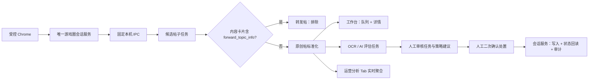
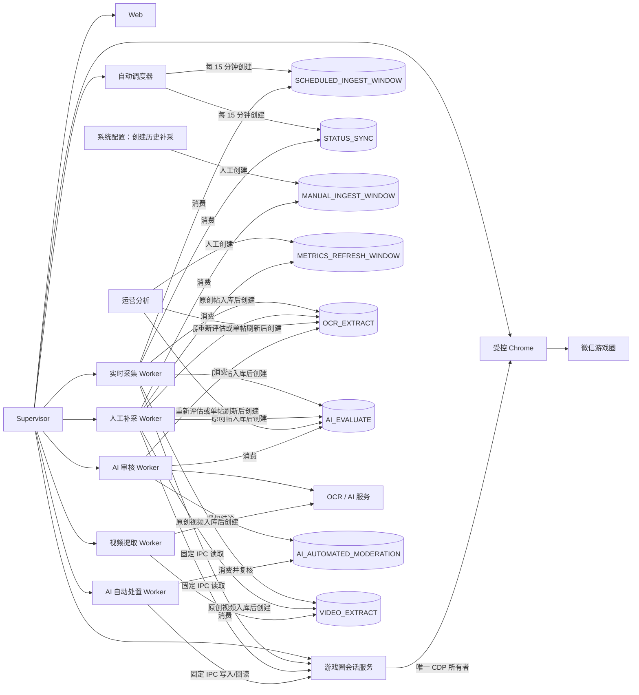
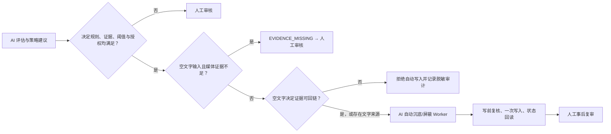

# 系统总览

微信游戏圈内容运营服务是一个 Django + SQLite 单体内部工具。它通过本机已登录 Chrome 的 CDP 读取原平台数据，筛选原创帖子，为运营人员提供“队列 + 详情”的管理工作台，并将 AI 建议、人工处置和运营分析统一留痕。

## 一眼看懂



核心原则：AI 自动处置默认关闭；只有人工与 AI 双重开关、策略规则逐条授权、严格证据/置信度检查同时满足时，才可自动沉底或屏蔽，并必须进入人工事后复审。禁言、恢复、回复和所有其他上游写入仍需人工确认。Cookie、令牌、完整已认证 URL、运营者身份标识和评论正文均不持久化；仅管理详情的发帖作者用户 ID会按最小范围保存，用于禁言状态与历史帖子关联。

## 模块

| 模块 | 职责 | 主要入口 |
| --- | --- | --- |
| `config` | Django 配置、SQLite 初始化、CDP 会话桥接、敏感日志脱敏。 | `config/settings.py`、`config/cdp.py` |
| `jobs` | 持久化后台任务、幂等键、检查点、重试和按任务类型隔离的 Scheduler/Worker。 | Supervisor 托管的 Scheduler、采集 Worker、AI Worker |
| `posts` | 候选帖采集、原创/转发判定、游戏目录缓存、内容/媒体/投票投影、互动快照和工作台。 | `/`、`posts/services.py`、Admin 游戏目录 |
| `reviews` | OCR、AI 评估、策略建议、人工审核、回复草案本地持久化与上游操作审计。 | `reviews/tasks.py`、工作台审核栏 |
| `reporting` | 北京时间日期范围的只读实时运营分析与工作台页面。 | `/reports/` |

## 运行架构与任务流

日常只启动 Supervisor。它托管一个受控 Chrome、一个 Web、一个自动调度器、一个游戏圈会话服务、一个实时采集 Worker、一个人工补采 Worker、一个指标快照 Worker、一个 AI 审核 Worker、一个可选视频提取 Worker 和一个默认停止的 AI 自动处置 Worker；各 Worker 职责严格分离。受控 Chrome 使用独立 profile 和 loopback CDP，Supervisor 是其唯一进程所有者。Supervisor 为固定本机 IPC 注入独立 capability，SQLite 部署不允许启动同一 Worker 职责的第二个实例。

游戏圈会话服务是唯一的 CDP 所有者。它以 `SessionBootstrap` 统一建立 HOME、当前游戏确认/切换、Frame、身份绑定和最小只读验证；建立 Frame、检查外层会话、修复损坏 Frame 和保活候选是互斥的显式意图，健康 lease 会被复用而不会产生额外 HOME。只有全部成功才发布 ACTIVE lease。保活 Job 也只有在发布新 lease 后才成功；候选失败会清理未发布 HOME / Frame，并按类别有限重试或终态失败。新 lease 发布前旧 lease 持续可用，发布后旧 lease 等待已开始请求结束和最短退役期届满才关闭其自建 target；维护循环会独立执行该回收。每次来源请求由有截止时间、可取消的 SessionAccess 管理。session Worker 更换时 Supervisor 会先重启受控 Chrome；若新 generation 就绪超时，Supervisor 保留该 replacement Chrome 并由后续调和重试，不会反复关闭它。新 owner 不扫描、接管或关闭旧 generation 的 tab；运行态只保存固定状态和数量，不保存 target ID、token 或 URL。



### 进程角色

| 进程 | 数量 | 角色 | 不负责的事 |
| --- | ---: | --- | --- |
| 自动调度器（Supervisor 服务 `scheduler`） | 1 | 创建采集、状态巡检、指标同步，以及启用后按四小时桶创建会话保活 Job。 | 不连接 CDP、不读取微信、不调用 AI、不消费任务。 |
| 游戏圈会话服务（Supervisor 服务 `game_circle_session`） | 1 | 运行 Bootstrap、登录等待和可选 Repair；唯一持有 CDP、系统 target 与来源身份，并只消费可选保活 Job。 | 不消费帖子、指标或 AI Job。 |
| 实时采集 Worker（Supervisor 服务 `ingestion`） | 1 | 消费自动采集与状态巡检任务；经固定 IPC 读取来源并写入帖子、状态与互动快照；原创帖入库后创建审核流水线。 | 不消费人工补采、范围互动刷新或旧采集任务；不调用 AI，不执行上游写处置。 |
| 人工补采 Worker（Supervisor 服务 `backfill_ingestion`） | 1 | 消费人工历史补采、范围互动刷新、作者禁言回填和旧 `INGEST_WINDOW`；复用检查点逻辑。 | 不消费 Scheduler 创建的实时任务；不调用 AI，不执行上游写处置。 |
| 指标快照 Worker（Supervisor 服务 `metric_sync`） | 1 | 经固定 IPC 消费每日、每周与人工历史指标任务；仅保存白名单聚合快照。 | 不消费帖子任务；不保存 Cookie、token 或原始响应。 |
| AI 审核 Worker（Supervisor 服务 `review`） | 1 | 串行消费 OCR 与 AI 评估任务，写入 OCR、风险证据、审核建议和本地草案。 | 不创建定时任务，不直接读取微信，不执行上游写处置。 |
| AI 自动处置 Worker（Supervisor 服务 `ai_moderation`） | 1 | 仅消费已授权 AI 结论创建的自动沉底/屏蔽任务，写前后回读并建立事后复审记录。 | 不处理 OCR/AI 评估；不处理禁言、恢复、回复或未授权结论。 |
| 禁言维护 Worker（Supervisor 服务 `mute_maintenance`） | 1 | 消费永久禁言续期、禁言列表状态刷新和全量帖子作者禁言扫描，经固定 IPC 回读；只有续期任务可执行受控禁言。 | 不直接管理浏览器、认证材料或任意外部命令。 |
| 视频提取 Worker（Supervisor 服务 `video_extraction`） | 1 | 可选地消费 `VIDEO_EXTRACT`，在本机临时目录提取视频时间证据。 | 不使用 CDP Cookie，不保存视频/帧/音频，不向模型传视频 URL 或二维码目标。 |

实时采集与人工补采各自串行处理所属任务。首次补采近几天数据或人工范围互动刷新耗时较长时，自动创建的 15 分钟采集和状态巡检仍由实时采集 Worker 独立处理；AI 审核 Worker 同样独立。调度器的同一时间桶使用幂等键复用任务，避免重复创建。旧 `INGEST_WINDOW` 因无法可靠判断来源，始终由人工补采 Worker 兼容消费。

### 当前后台 Job

| Job 类型 | 生产者 | 消费者 | 作用与边界 |
| --- | --- | --- | --- |
| `GAME_CIRCLE_SESSION_KEEPALIVE` | 手动保活；启用后由 Scheduler 创建。 | 游戏圈会话服务 | 首次消费者执行时冻结当前游戏范围；以候选 HOME/Frame 完成 `A → B → A` 或直接对齐，验证后原子发布 lease。无当前范围时以 `NO_ACTIVE_GAME_SCOPE` 终态结束。 |
| `PERMANENT_MUTE_RENEWAL` | Scheduler 或运行节点的“执行一次”。 | 禁言维护 Worker | 禁言管理页面同步标记本服务的永久禁言意图；续期任务每天 00:00、12:00 入队，仅在到期不足 5 天或禁言时间为 0 时回读并续期。 |
| `AUTHOR_MUTE_STATUS_REFRESH` | 禁言管理的“刷新禁言列表用户状态”。 | 禁言维护 Worker | 入队时冻结当前游戏、禁言列表判断时刻和集合上界；逐位读取列表作者的用户详情并更新禁言截止，不执行上游写操作。 |
| `POST_AUTHOR_MUTE_STATUS_SYNC` | 禁言管理的“扫描全量帖子作者，补充被禁言用户”。 | 禁言维护 Worker | 入队时冻结当前游戏和原创帖子集合上界；按作者去重读取用户详情，只将仍禁言作者补充到列表，不设置永久禁言。 |
| `SCHEDULED_INGEST_WINDOW` | 自动调度器。 | 实时采集 Worker | 按 AppID、时间窗口和页大小，经固定 IPC 断点拉取候选帖，判定原创/转发并保存帖子、媒体、投票和互动数据。每页更新 checkpoint。 |
| `STATUS_SYNC` | 自动调度器。 | 实时采集 Worker | 每 15 分钟回读最多 20 条最久未更新的待审核原创帖，只更新上游状态和互动快照，不修改本地审核结论。 |
| `METRIC_DAILY_SYNC` / `METRIC_WEEKLY_SYNC` / `METRIC_BACKFILL` | 自动调度器或人工回填。 | 指标快照 Worker | 每日 07:30 后同步昨天并复核近期日窗口；周一 17:30 后同步已完成周并复核近期周窗口；同一快照按业务键更新。 |
| `MANUAL_INGEST_WINDOW` | 系统配置首页“创建历史补采”。 | 人工补采 Worker | 按选定可管理游戏和最近小时数断点拉取候选帖；不会阻塞自动采集。`enqueue_ingestion` 仅用于诊断。 |
| `METRICS_REFRESH_WINDOW` | 运营分析页“刷新本范围数据”。 | 人工补采 Worker | 仅按当前时间范围内已入库原创帖的 `topic_id` 回读浏览、点赞、评论和分享；不采集转发帖，不更新正文或状态。 |
| `AUTHOR_MUTE_STATUS_BACKFILL` | 一次性回填命令。 | 人工补采 Worker | 逐帖读取当前详情，将作者禁言观察同步到本地禁言状态表，并保存游标 checkpoint。 |
| `INGEST_WINDOW` | 升级前历史存量。 | 人工补采 Worker | 兼容旧采集窗口及其已有 checkpoint；新代码不再创建此类型。 |
| `OCR_EXTRACT` | 原创帖采集完成、单帖刷新、人工重新评估或诊断命令。 | AI 审核 Worker | 提取原创帖图片文字，供后续 AI 评估使用。 |
| `AI_EVALUATE` | 与 `OCR_EXTRACT` 成对创建。 | AI 审核 Worker | 基于正文、投票和 OCR 输出分类、风险依据、置信度与审核建议；仅在独立自动处置授权全部满足时，同一事务创建后续自动处置任务。 |
| `AI_AUTOMATED_MODERATION` | AI 审核 Worker 在同一事务内创建。 | AI 自动处置 Worker | 仅对授权且高置信度的沉底/屏蔽结论执行一次；成功后进入 AI 操作复审。 |
| `VIDEO_EXTRACT` | 启用视频审核后，原创帖的视频媒体。 | 视频提取 Worker | 受限 HTTPS 本地读取、抽帧二维码检测/OCR 和可选 ASR；失败不阻塞 AI。仅空文字输入且该媒体没有可用当前证据时进入重点人工核验。 |

### 定时入队

所有时间均为北京时间；Scheduler 每 30 秒轮询，但同一业务时间槽按幂等键只创建一次 Job。

| 时间 | Job |
| --- | --- |
| 每 15 分钟整点 | `STATUS_SYNC`、`SCHEDULED_INGEST_WINDOW` |
| 启用会话保活后，每个北京时间四小时桶 | `GAME_CIRCLE_SESSION_KEEPALIVE` |
| 每日 00:00、12:00 | `PERMANENT_MUTE_RENEWAL` |
| 每日 07:30 后 | `METRIC_DAILY_SYNC` |
| 周一 17:30 后、周二 10:00 后、周二 16:00 后 | `METRIC_WEEKLY_SYNC` |

未选择当前操作游戏时，Scheduler 跳过所有需要游戏范围的来源 Job；已入队保活在首次消费时以 `NO_ACTIVE_GAME_SCOPE` 终态结束，不创建浏览器页面。

## 系统配置与追溯台

`/admin/` 是“系统配置与追溯台”，不是第二个内容管理入口。顶部可在内容管理、运营分析和系统配置之间切换；首页 Hero 下方的“初始化与运行状态”Pipeline 优先展示 Supervisor、默认策略、AI/OCR、CDP 和三个业务节点的就绪状态与下一步。其中帖子采集 Worker 节点同时管理实时采集和人工补采两个进程，并提供各自日志入口。

- 可编辑配置包括审核策略版本、审核策略规则，以及 Pipeline 中白名单 AI/OCR 配置和人工处置开关。密钥只可写入、不会回显；AI/OCR 变更重启 AI Worker，处置开关变更重启 Web。策略规则用于维护风险标签、最低置信度、优先级和建议动作；首页默认折叠当前启用策略的规则摘要，展开后可查看中文风险类型、阈值、建议动作和优先级。规则编辑列表同时保留风险编码与中文释义。
- Supervisor 启动预检会幂等初始化“通用内容审核策略”。它包含通用违规、无关内容、负面灌水、交易风险和内容异常的基线规则；预检不覆盖已有规则，且只会在没有启用策略时启用该默认版本。`ensure_default_policy` 仅用于诊断或恢复。
- 帖子采集 Worker 节点提供“创建历史补采”弹窗：从本地可管理游戏目录选择游戏，默认城主别慌张，输入最近 1 至 744 小时。它只创建 `MANUAL_INGEST_WINDOW`，不会在页面请求中连接 CDP；人工补采 Worker 未运行时任务保持待执行。
- 可管理游戏目录不能手工新增、修改或删除；系统配置台的“同步可管理游戏”通过固定 IPC 读取当前受控 Chrome 会话中的授权游戏，并在同一操作内更新本地缓存。同步失败会保留本地目录。
- “当前操作游戏”节点只配置全局业务范围：显示选定游戏、允许更换游戏并建立对应 Frame，目录刷新仅作为选择器的次级操作。外层会话检查归“受控 Chrome 会话”节点；手动保活和自动维护开关归“游戏圈会话服务”节点。范围版本和页面检查时间不作为该节点的日常操作信息。
- 候选帖子、原创帖子、媒体、互动快照、OCR、AI 评估、风险证据、审核任务、回复草案、操作审计和后台任务均为只读追溯数据，可搜索、筛选和查看关联详情。
- 对帖子或审核任务，配置台提供“在内容管理中查看”链接。沉底、屏蔽、禁言、恢复和批量处置只允许从内容管理工作台发起；历史 Admin 处置地址会明确返回不可用，且不会写入审计。

## 表结构

数据库文件默认位于 `runtime/operations.sqlite3`。`runtime/` 统一保存部署配置、数据库、收集后的静态文件、Worker 锁和可选运行日志；该目录不纳入代码包。完整字段、枚举、关系和约束见[数据库数据字典](../technical/database-schema.md)。

## 数据与判定

### 原创帖

候选列表不直接决定帖子类型。系统会对每条候选调用内容卡片详情：`forward_topic_info` 字段存在且值不为 `null` 即标记为转发帖；该候选记录仅保留最小判定信息供统计，不进入工作台或原创报表。字段缺失或值为 `null` 时才作为原创帖保存。

原创帖保存正文、图片/视频引用、互动快照、投票文本和管理详情返回的作者用户 ID。作者昵称只保存到独立的按游戏禁言状态观测，不保存头像、评论或评论作者载荷；作者用户 ID不进入普通报表和通用搜索。

### 业务删除

管理详情返回已验证的业务错误码 `-10075007` 时，系统为 `status` 添加本地删除位 `128`。删除位可与屏蔽 `4`、沉底 `8` 组合，正常仅为基值 `2`，不参与按位组合。该状态仍会显示在工作台、搜索和原创统计中，供历史追溯；不可执行任何上游处置，但可以重新评估以更新本地风险证据。若内容卡片仍可读，刷新会只读补齐历史正文、媒体和投票，不会清除删除位；只有后续管理详情重新成功才会以原平台状态覆盖该值并恢复可运营性。

### 互动与评论

浏览、点赞、回复和分享数以时间快照保存。详情接口中的评论列表和作者信息会被丢弃，不保存评论正文。

## 工作台交互

访问 `/` 登录后进入工作台：

1. 内容管理标题旁为单选游戏上下文；未提供或无效 AppID 时默认“城主别慌张”，不提供全部游戏或多选范围。左侧原创帖子队列仅在当前游戏内支持正文、投票文本、类别、风险、建议动作、审核状态和优先级排序筛选；除游戏外的多选维度按 OR 匹配，未选择任何值即不过滤该维度。快速筛选“待处理推荐”预选沉底、屏蔽、禁言、人工判断、待审核和正常状态。
2. 中间主阅读区展示正文、投票内容、图片/视频附件与最新互动指标。
3. 详情顶部横向展示 AI 评估状态、重新评估、内容分类、置信度、审核优先级和策略建议；风险依据默认折叠，展开后在原位置显示证据与模型/策略版本。安全原创帖存在本地回复草案时会在风险依据后显示可折叠“回复建议”，提供三种风格，可编辑、复制或标记本地已采纳；未命中 FAQ 的通用草案会明确标识，不显示伪造来源或待补充信息。
4. 右侧为随页面滚动保持可见的悬浮处置卡。AI 建议只在对应操作上显示 `AI 推荐` 角标，不会自动操作原平台；回复建议同样仅保存在本系统，绝不调用原平台发布或评论接口。
5. 使用上一条、下一条或 `J`、`K`、左右方向键在当前筛选结果中切换帖子；点击图片或视频在页内模态框预览，预览中可用左右方向键切换附件。
6. “刷新数据”会回读管理详情、内容卡片、媒体、投票和可用互动指标。处置卡展示状态：`2` 正常、`4` 屏蔽、`8` 沉底、`16` 仅自己可见、`128` 原平台已删除；删除可与屏蔽、沉底组合且会禁用全部审核处置。仅自己可见可保留本地审核记录，但不会触发任何上游处置，避免覆盖未验证的原平台可见性状态。
7. 顶部账户名左侧分开展示“外层会话”和“当前游戏 Frame”。外层有效不代表来源可用；只有 Frame 有效代表当前 scope 的 ACTIVE lease 已通过最小读取验证。Frame 未就绪时由运营人员明确建立当前游戏 Frame；检查登录态只检查外层，不切换游戏或建立 Frame。只有“需扫码登录”允许打开/复用唯一人工登录页；自动流程始终后台建页、不会聚焦、弹窗或跳转。来源调用无 lease 时只返回未就绪，恢复后人工写入必须重新确认，绝不自动重放。

游戏选择器读取本地缓存目录。管理员可在系统配置与追溯台的“同步可管理游戏”直接刷新名称；同步需要已登录的受控公众平台页面，失败时保留上次缓存且不影响工作台。

## 审核与处置

AI 评估会输出内容类别、风险证据、置信度与建议动作，但所有结果都进入人工审核。高额奖励只是模型判定风险的语境，孤立奖励不能单独定性私服或引流；在决定规则、决定风险依据、阈值和授权均满足时，不因奖励、单项 OCR 失败、视频部分完成或静音而额外否决自动沉底/屏蔽。只有标题、正文和投票均为空且媒体证据不足时，任务才标记 `EVIDENCE_MISSING`；空文字自动处置还必须在写前回链当前图片 OCR 或视频时间证据，回链失败只拒绝自动写入并留下脱敏审计。安全帖命中受控 FAQ 时使用其场景和来源生成草案；未命中时只允许生成无来源、无事实承诺的通用草案，并在工作台标识未命中。工作台不提供人工标签或 AI 正误反馈；对已有回复草案的帖子，运营人员可在详情内编辑、复制和标记本地已采纳。采纳不代表已回复用户，系统不会自动或手动通过该入口发布到原平台。



工作台支持以下人工动作：跳过、沉底、屏蔽、禁言、解除禁言、恢复正常。

- 跳过只完成本地人工审核，不发送上游请求。
- 屏蔽和禁言要求选择已验证的违规原因；禁言默认预选“其他”和 30 天，但运营人员可修改，服务端会在未提交禁言原因时采用同一默认值。
- 禁言与解除禁言会先读取管理详情，核验原创、删除/可处置状态、当前游戏禁言及作者用户 ID；写前 ID与已同步值不一致时拒绝写入。写后立即回读，并只在 2、5、10 秒补读，绝不重复写请求。写接口失败即使回读达标也保留 `ACTION_FAILED`。
- 每次上游操作均创建审计记录，使用“帖子 + 动作 + 本次确认令牌”去重，并读取前后状态验证结果；跳过也会记录人工最终动作和业务原因。
- 操作失败、会话失效、响应结构变化或状态不一致均记录为 `ACTION_FAILED`，不会自动重试。
- 单条人工刷新或处置在经认证、CSRF 二次确认后，可同步通过会话协调器取得即时结果；Web 仅使用已登记的插件会话，不创建/扫描/关闭受协调器管理的 target，不切换游戏、不重建插件、不直接绑定身份。会话不可用时要求运营人员先建立 Frame，再重新确认；人工扫码可显式打开固定、无认证登录页，但该入口不读取认证信息或接管会话。

工作台还提供人工触发的批量执行入口：只从当前队列取最多 20 条同时满足“原创、状态正常、待审核、AI 建议为沉底或屏蔽、存在风险依据”的帖子。每条都会独立回读上游状态、写入审计并完成本地审核；任一条失败不会中断其他帖子。批量屏蔽固定使用上游违规原因“其他”（`1`），沉底与屏蔽的业务原因均由可读的 AI 风险依据摘要生成。禁言、人工判断、屏蔽并禁言和无风险依据的建议不会进入批量操作。它与单条人工操作保持同步确认与即时汇总语义；会话不可用时不执行剩余项，也不会在恢复后自动重放。

真实上游写入需同时启用 `ENABLE_UPSTREAM_WRITES=true` 与对应的单项开关。人工确认始终可按既有流程使用；AI 自动沉底/屏蔽还要求 `ENABLE_AI_AUTOMATED_MODERATION=true`、对应 AI 动作开关和策略规则逐条授权。AI 自动 Worker 不可执行禁言、恢复、回复或任何其他动作。

AI 写入成功后不会伪装为人工审核完成：审核任务进入“AI 已执行待复审”，并以不可变的模型、策略、规则、依据与授权快照创建独立复审记录。人工确认正确才完成审核；标记异常进入人工跟进，只有既有人工恢复正常操作成功后才将复审记录标为已恢复。

## 日常运行

### 采集

1. 启动 Supervisor，由其启动受控 Chrome；在固定公众平台登录页完成手动扫码。
2. 对城主别慌张，Supervisor 托管的 Scheduler 按北京时间每 15 分钟创建最近 30 分钟的采集任务。超过 30 分钟的历史补采在系统配置首页“帖子采集 Worker”创建指定游戏和最近小时数的任务；`enqueue_ingestion` 仅用于诊断。
3. Supervisor 托管的实时采集 Worker 拉取 Scheduler 创建的帖子；人工补采 Worker 拉取人工窗口与运营分析互动刷新任务。两者均按页保存 checkpoint，中断后可恢复。
4. Supervisor 托管的 AI Worker 消费 OCR 与 AI 审核任务；它不会认领帖子拉取任务。
5. 调度器每 15 分钟还会创建一项待审核帖子状态巡检；实时采集 Worker 每次最多回读 20 条最久未更新的待审核帖，只更新上游状态和互动数据，不改变本地审核状态。
6. 在工作台查看原创帖子；必要时对单帖执行刷新。

### AI 和运营分析

- AI/OCR 仅在配置对应 OpenAI 兼容接口后可运行。AI 评估通过 `AI_EVALUATE` 后台任务执行。
- “运营分析”Tab 按北京时间日期范围和游戏实时读取候选、原创、审核与互动数据；默认最近 7 天（含当天），单次最多 31 天。每个帖子的互动仅取最新快照，不生成分析记录或 CSV；运营人员可创建由人工补采 Worker 异步执行的范围互动刷新任务。高互动排行、AI 建议分布与 AI/人工一致率属于后续能力。
- Supervisor 托管的 Scheduler 仅为城主别慌张创建状态巡检与 30 分钟采集窗口；它不直接拉取数据、调用 AI 或调用上游写适配器。AI 任务在原创帖采集后自动入队。

## 配置与安全

运行配置持久化于 `runtime/.env`，模板见 [`.env.example`](../../.env.example)。部署时先创建 `runtime/`，再复制模板；日常 AI/OCR 与人工处置授权均通过 `/admin/` 的配置弹窗保存，禁止将 `.env` 作为常规操作入口：

```bash
mkdir -p runtime
cp .env.example runtime/.env
```

| 配置组 | 用途 |
| --- | --- |
| `AI_*`、`OCR_*` | OpenAI 兼容 AI/OCR 服务地址、密钥和模型。 |
| `ENABLE_UPSTREAM_WRITES` | 上游写操作总开关。 |
| `ENABLE_SINK_WRITES`、`ENABLE_BLOCK_WRITES` | 沉底、屏蔽开关。 |
| `ENABLE_MUTE_WRITES`、`ENABLE_UNMUTE_WRITES` | 禁言、解除禁言开关。 |
| `ENABLE_RESTORE_WRITES` | 恢复正常开关。 |
| `SESSION_REPAIR_ENABLED` | 默认 `false`；仅检查 current-owner HOME/Frame，失效时合并一次 Bootstrap。 |
| `SESSION_KEEPALIVE_ENABLED` | 默认 `false`；Scheduler 仅在启用后接受未来四小时桶，已入队任务保持原队列语义。 |

不要将浏览器 Cookie、令牌、完整跳转 URL、运营者身份标识或未脱敏的作者用户 ID写入 `runtime/.env`、文档或日志。作者用户 ID仅允许保存到原创帖与作者禁言状态表，不进入报表或通用搜索。

## 相关文档

- [文档中心](../README.md)
- [快速启动与配置](../../README.md)
- [数据库数据字典](../technical/database-schema.md)
- [原平台接口调研](../research/wechat-game-circle-original-posts-research.md)
- [运行、备份与恢复手册](operations-runbook.md)
- [原始需求方案](../prd/content-operations-platform-requirements.md)
- [OpenSpec 主规格](../../openspec/specs)
