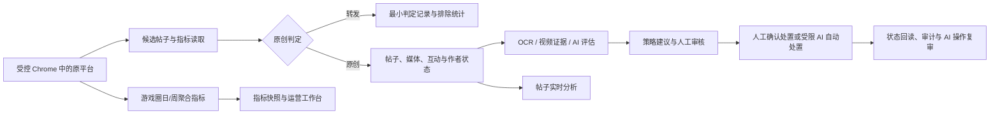

# 内容运营平台需求方案

版本：v0.3（实现对齐版）
日期：2026-07-21
关联调研：[原创帖拉取](../research/wechat-game-circle-original-posts-research.md)、[游戏圈数据分析](../research/wechat-game-circle-data-analysis-research.md)

## 文档定位

本文是内容运营平台的产品基线：已发布能力以版本发布清单、迁移和已确认升级为准；当前工作区已实现但尚未发布的能力必须单独标注。未交付事项必须明确标注为规划，不得写成现有功能。部署、服务职责和操作细节见[系统总览](../guides/system-overview.md)，字段和关系见[数据库数据字典](../technical/database-schema.md)。

当前已发布：原创/转发判定、断点采集、受控游戏目录、作者禁言状态、图片 OCR、可选视频证据、AI 异步评估、策略建议、人工审核、受控人工处置、AI 自动沉底/屏蔽及人工事后复审、FAQ 驱动的本地安全回复草案、帖子实时分析，以及游戏圈日/周聚合指标快照。评论正文治理、原平台回复发布、人工 AI 反馈和模型质量闭环仍未交付。

## 1. 背景与目标

游戏圈运营面临原创帖与转发帖混杂、风险内容人工筛选成本高、帖子状态与作者禁言状态分散、互动和游戏圈经营指标缺乏可追溯历史等问题。平台在不替代原平台内容能力的前提下，建立以下受控闭环：

### 目标

- 只让原创帖进入内容审核与原创帖分析；转发帖保留最小判定记录，不进入运营池。
- 以 AI 提供可核验的分类、风险证据、建议动作和优先级，但保持人工审核为默认边界。
- 使人工或受限 AI 写操作可验证、可回读、可审计，且不会泄露会话凭据。
- 将作者当前游戏/全局禁言观测独立保存，支持工作台判断和禁言管理查询。
- 将帖子实时数据与游戏圈日/周经营快照分层展示，明确业务日期和数据完整性。

### 非目标

- 不替代原平台的发帖、评论发布、编辑、置顶、话题和素材管理。
- 不采集、持久化或审核评论正文及评论作者载荷；评论数仅为互动指标。
- 不保存 Cookie、会话令牌、完整认证 URL、认证账号标识、原始指标响应或视频/音频/帧二进制。
- 不由 AI 自动禁言、解除禁言、恢复、回复或执行任何未逐项授权的上游写操作。
- 不将 7/14/30 日查询窗口误表示为留存率；当前只保存已验证的游戏圈活跃用户值。

## 2. 使用范围与安全原则

首期不区分产品内角色；所有已登录运营人员可在相同的游戏上下文中查看内容、审核、执行已授权处置、查看禁言状态和运营指标。系统仍必须记录人工操作人、时间、动作、原因、关联 AI 依据及脱敏结果。

以下原则不可突破：

- 原平台读取和写入仅通过本机受控 Chrome 的已授权 CDP 会话完成；页面请求不得自行建立任意上游会话。
- 人工处置须二次确认；相同确认令牌不得重复写入。AI 自动处置只允许沉底/屏蔽，并在成功后进入人工事后复审。
- 本地回复草案绝不调用原平台评论或发帖接口；“本地采纳”不代表已回复玩家。
- 任何上游失败、登录失效、结构变化或状态回读不一致均须保留脱敏诊断并停止该次动作，不得无限重试写入。

## 3. 核心业务定义

| 概念 | 定义 |
| --- | --- |
| 原创帖 | 管理详情的 `forward_topic_info` 缺失或为 `null` 的帖子。 |
| 转发帖 | `forward_topic_info` 存在且非 `null` 的转发帖子/评论链内容。 |
| 受控游戏 | 从受控微信会话同步到本地目录、可在工作台选择的游戏；不可手工增删改。 |
| 作者禁言状态 | 以 `openid + source_appid` 维护的最近状态观测，包含当前游戏与全局禁言有效期、昵称和同步时间。 |
| AI 评估 | 对原创帖文本、投票、图片 OCR 和可用视频证据输出的结构化分类、风险、证据、置信度和建议动作。 |
| AI 自动处置 | 满足总开关、动作开关、策略逐条授权、证据、置信度、状态和限额的沉底/屏蔽一次性任务；不是人工审核的替代。 |
| 指标快照 | 单游戏、单来源、单业务日或周的白名单聚合指标，以稳定业务键幂等更新。 |
| 完整业务日 | 五个已启用日指标来源都存在记录的同一最近业务日，可用于日 KPI 并列展示。 |

## 4. 功能需求

### 4.1 数据接入、原创过滤与游戏目录

**FR-01 候选帖采集与原创判定**

- 系统通过受控来源分页读取候选帖子，自动采集按固定窗口运行，人工历史补采按选定游戏和最近小时数创建独立任务；两者均保存 checkpoint 并可恢复。
- 每条候选帖通过内容卡片详情判定：`forward_topic_info` 非空为 `FORWARD`，仅保留最小候选判定记录；缺失或 `null` 为 `ORIGINAL`，进入标准化、OCR/AI 和工作台。
- `content_id` 缺失、详情失败或结构异常时必须标为 `CLASSIFICATION_PENDING`，不得默认当作原创帖或发起上游处置。
- `topic_id` 是帖子业务主键，`content_id` 是内容卡片查询键；重复采集必须幂等更新。

**FR-02 原创帖标准化与作者状态**

- 原创帖保存标题、正文文本、媒体引用、投票文本、发布时间、来源状态、互动快照和来源游戏；评论正文及评论者数据立即丢弃。
- 管理详情返回的发帖者 `openid` 保存为 `author_openid`，仅用于同作者原创帖关联、作者禁言状态同步及人工禁言/解除禁言前的身份比对；不进入普通报表、通用搜索或默认页面展示。
- 作者昵称仅保存到独立的作者禁言状态观测；不持久化头像。
- 受控游戏目录只能由“从受控微信同步可管理游戏”更新；同步失败必须保留本地目录，不影响既有工作台。

**FR-03 状态和互动同步**

- Scheduler 每 15 分钟创建最近窗口采集和最多 20 条待审核原创帖的状态巡检；巡检只更新原平台状态与互动快照，不改变本地审核结论。
- 互动快照保存浏览、点赞、评论和分享数。运营人员可对当前日期范围创建互动刷新任务；该任务只回读已入库原创帖互动，不刷新正文、不重跑 AI、不改变审核或上游状态。
- 管理详情返回已验证删除错误时，系统为状态添加本地删除位 `128`；删除帖保留历史并可本地重评，但禁止全部上游处置。后续管理详情重新成功时才能清除该本地删除状态。

### 4.2 AI 内容理解与证据

**FR-04 结构化评估与风险识别**

- AI 仅评估原创帖，输入包含标题、正文、投票、图片 OCR 与可用的视频受限证据；结果必须通过结构化 Schema 校验。
- 主类别为攻略、反馈、建议、求助/问答、活动/资讯、晒图/社交、无关内容或其他；可附次级类别。
- 风险标签至少覆盖引流、私服、外挂、诈骗交易、人身攻击、色情、无关广告、纯负面灌水和内容异常。每个标签必须有独立置信度与正文、投票、OCR 或视频时间位置证据。
- 负面但有具体问题、复现信息或改进建议的内容必须归为反馈/建议，不得仅因负面情绪建议沉底。
- 标题、正文和投票均为空时，帖子没有媒体、任一图片缺少可用 OCR 文本或任一视频缺少当前媒体证据，必须以 `EVIDENCE_MISSING` 标记需重点人工判断；单项 OCR 失败、视频部分完成、静音视频或空正文自身不得作为独立重点原因。

**FR-05 视频证据边界**

- 对原创视频可选执行本地受限下载、抽帧 OCR/二维码存在检测和可选语音转写；不保存视频、帧、音频、视频 URL、二维码目标或浏览器会话。
- 视频证据仅向模型提供来源媒体、时间位置和受限文本摘要；提取失败或证据不足不得推断为“无风险”。只有空文字输入且该媒体缺少可用当前证据时，才触发重点人工判断。
- 二维码只是联系方式/引流线索，不得声称已访问或解析其目标；高额奖励数值本身不得直接定性私服或引流，也不得单独成为重点人工判断或否决已获规则授权的自动处置。

### 4.3 策略、审核与本地回复草案

**FR-06 策略建议与人工审核**

- 策略按风险标签、阈值、例外条件、建议动作和审核优先级配置、版本化并保留命中依据。
- 所有已评估原创帖默认进入人工审核；AI 建议影响排序和视觉提示，不替代人工最终决定。
- 工作台支持按单一游戏上下文、类别、风险、置信度、建议动作、审核状态和优先级筛选；详情展示正文、媒体、互动、评估、证据、模型/提示词/策略版本和当前状态。
- 支持人工跳过、沉底、屏蔽、禁言、屏蔽并禁言、解除禁言和恢复正常。删除帖不可处置；跳过只完成本地审核。

**FR-07 作者禁言状态与禁言管理**

- 同步管理详情时，系统解析并更新作者的当前游戏禁言截止时间、全局禁言截止时间、昵称和最近同步时间；全局值为 `0` 时表示无全局禁言。
- 审核详情必须区分已确认未禁言、有效当前游戏禁言、有效全局禁言和状态未知；有效禁言时禁用重复禁言。
- 人工禁言/解除禁言写前必须读取详情，核验原创、删除/可处置状态、作者身份和当前游戏禁言；写后立即回读，并仅在 2、5、10 秒补读，不重复发送写请求。
- “禁言管理”在相同游戏上下文中列出作者昵称、当前游戏/全局禁言、有效期、最近同步时间和关联原创帖入口；不提供批量禁言、自动解除或自动重试写操作。

**FR-08 受控上游操作与 AI 操作复审**

- 所有人工上游写操作使用“帖子 + 动作 + 确认令牌”构成的幂等范围，记录唯一操作标识、原因、前后状态、脱敏结果、执行者和时间。
- 屏蔽、沉底、禁言、解除禁言和恢复为独立能力开关。未验证、未启用、会话失效、响应异常或回读不一致时记录 `ACTION_FAILED`，不得无限重试。
- 人工可批量执行当前队列中最多 20 条满足“原创、正常、待审核、有风险依据且 AI 建议沉底/屏蔽”的帖子；每条独立回读和审计，单条失败不阻断其余条目。禁言、人工判断、屏蔽并禁言不进入批量操作。
- AI 自动处置默认关闭，只允许被逐项授权的沉底/屏蔽。成功后必须进入“AI 操作复审”；运营人员可确认正确，或标记异常并通过既有人工流程纠正，系统不得自动恢复或自动重试。
- 自动处置只使用内容管理当前建议所记录的决定策略规则、决定风险依据、规则阈值和运行时授权；不得因其他低置信度风险或固定全局阈值改写建议。`EVIDENCE_MISSING`、帖子/评估状态异常、未授权、配额、幂等或写前复核失败必须保留人工审核。空文字输入还必须在写前将决定依据回链到当前图片 OCR 或视频时间证据；历史任务仍含旧重点原因时不得自动写入。

**FR-09 本地回复草案**

- 对安全原创帖持久化三风格本地草案。命中当前游戏受控 FAQ 时保存场景、版本、来源和待补充信息；未命中时允许生成明确标注“未命中 FAQ 规则”的通用草案，且这些来源性字段必须为空。
- 含引流、私服、外挂、诈骗、色情、人身攻击或建议屏蔽/禁言的帖子不得生成公开回复草案。
- 草案可在审核详情中选择一种候选后编辑、复制和标记本地采纳；系统必须明确“仅本地记录，未发布到原平台”，不得调用原平台评论或发帖接口。
- 通用草案不得编造客服路径、活动事实、待补充信息、来源或任何无来源的事实性承诺。

### 4.4 运营分析与游戏圈指标快照

**FR-10 帖子实时分析**

- “运营分析”保留按单一游戏、北京时间起止日期查询的帖子实时分析，默认最近 7 天（含当天），单次最多 31 天。
- 查询展示候选、原创、转发排除、待判定、内容类别、风险、人工最终动作、待审核、互动总量和本地回复草案统计；每帖互动仅取最新快照。
- 页面请求只读取本地数据，不建立 CDP 会话、不请求上游，也不写指标快照。

**FR-11 游戏圈日/周聚合指标快照**

- 首期仅为城主别慌张保存白名单聚合快照。日来源为游戏圈粉丝、内容消费、内容创作、内容分享和游戏圈活跃用户；内容粉丝来源保持禁用，未验证前不得入队。
- 快照以 `appid + source + period_start + period_end + scope` 为稳定业务键。范围缺日、字段缺失或失败不得补零、写空值或覆盖既有有效快照。
- Scheduler 在每日 07:30 后入队日同步并复核 `D-2` 至 `D0`，在周一 17:30、周二 10:00、周二 16:00 入队最近三个已完成周的复核；人工可创建按来源和日期范围的回填任务。登录失效延后且不消耗重试次数，权限/契约错误终态失败，临时传输或限流故障有限退避。
- 每日工作台仅在五个日来源存在同一最近业务日时进行并列展示；否则逐卡展示各自日期或缺失，并明确“不完整”，不得产生跨日期漏斗、转化、健康判断或跨域环比。
- 周度运营效果区分 `VERIFIED` 与 `PENDING_RECHECK`。核心指标全零的疑似上游占位结果不得覆盖已验证周，也不得显示为真实零；周度页面只使用已验证周并提示较新的待复核周期。

## 5. 页面与用户流程

| 页面/Tab | 当前能力 |
| --- | --- |
| 内容管理 | 单游戏原创帖队列、筛选、阅读区、媒体预览、AI 证据、回复草案、人工处置和状态回读。 |
| 禁言管理 | 当前游戏的作者禁言状态列表、期限、同步时间与关联帖子访问。 |
| AI 操作复审 | 查看 AI 自动沉底/屏蔽的不可变安全快照，并由人工确认或发起纠正。 |
| 运营分析 | 帖子实时分析，以及分层的每日运营/周度复盘指标快照；显示业务日期与缺失提示。 |
| 系统配置与追溯台 | Supervisor、CDP、Worker、任务、策略、游戏目录、只读追溯数据和运行配置。 |

受控 Chrome 登录态在工作台异步展示：有效时为不可点击状态；无效时只能在受控 Chrome 中打开固定未认证登录页，当前工作台浏览器不得跳转到登录页。

## 6. 数据模型

| 实体 | 核心内容 |
| --- | --- |
| 候选帖与原创帖 | 候选判定、`topic_id`、`content_id`、来源游戏、正文/媒体/投票、状态、互动和 `author_openid`。 |
| 作者禁言状态 | `openid`、来源 AppID、昵称、当前游戏/全局禁言有效期、首次发现与最近同步时间。 |
| AI 评估与审核任务 | 分类、风险依据、模型/提示词/策略版本、建议动作、重点原因和人工审核状态。 |
| 视频提取与证据 | 提取状态、受限文本/二维码存在/时间位置证据；不保存二进制或来源 URL。 |
| 回复草案 | 本地正文、诉求、待补充信息、来源、风险提示和本地采纳状态。 |
| 操作审计与 AI 操作复审 | 人工/AI 来源、幂等键、前后状态、脱敏结果和复审状态。 |
| 游戏圈指标快照 | 业务键、白名单指标 JSON、业务日/周、发布稳定性状态、采集时间和最近任务。 |
| 后台任务与租约 | 任务类型、幂等键、checkpoint、重试、错误摘要及人工指标回填的活跃任务租约。 |

## 7. 运行与可靠性要求

- 日常由 Supervisor 托管 Web、Scheduler、实时采集、人工补采、指标同步、AI 审核、可选视频提取和默认停用的 AI 自动处置服务；同一 SQLite Worker 职责不得并行启动多个实例。
- Supervisor 启动预检执行数据库迁移、静态资源采集和默认策略初始化。服务健康、心跳、日志和控制只能经本机受保护通道访问。
- 采集、指标同步、OCR、AI、视频提取和自动处置均为可查询后台任务，保留 checkpoint、有限重试和脱敏错误；任务失败不得伪装为完成。
- 密钥只可通过受控运行配置写入且不回显。日志、数据库、页面、分析和导出不得记录认证上下文、评论正文或原始上游响应。

## 8. 交付状态与后续规划

### 当前已发布

- 原创过滤、采集恢复、受控游戏目录、状态巡检、互动刷新、作者禁言状态和禁言管理。
- 图片 OCR、可选视频证据、AI 评估、策略建议、人工审核、本地回复草案和操作审计。
- 人工处置、批量 AI 建议执行、受限 AI 自动沉底/屏蔽及人工事后复审。
- FAQ 驱动的安全回复草案：受控资料覆盖安全的问答、活动和社区互动，并提供亲和互动、简洁处理、正式稳妥三种可选正文；保留“仅本地、不发布、高风险不回复”边界。
- 帖子实时分析，以及游戏圈日/周聚合指标快照、回填、业务日期完整性和周度稳定性复核。

### 后续需独立评审

- 评论治理、原平台回复发布、人工分类/标签或 AI 正误反馈、模型质量看板、趋势预警、跨游戏策略复用、导出和角色权限。
- **按作者查询的禁言状态与续期核验**：作者禁言状态的读取、刷新与永久禁言续期应以已保存的 `openid + appid` 调用经验证的用户详情接口为唯一来源，不得为了取得作者身份或禁言截止时间依赖 `topicsearchgetdetail`。帖子详情只保留给内容状态和人工帖子处置的可处置性核验；帖子已删除时仍拒绝从该帖子发起人工处置，但不得阻断既有作者禁言记录的状态刷新或续期核验。用户详情响应仅解析昵称、当前游戏禁言截止与全局禁言截止，丢弃其附带帖子列表和原始响应。实施前须明确会话来源、错误分类和请求上限；最小验证为：将关联代表帖子标记为删除后，针对该作者的刷新或续期预检仍只发起一次用户详情读取、更新 `AuthorMuteStatus`，且不发起帖子详情读取或上游写操作。
- **可配置调度生产者**：将当前由 Scheduler 固定创建任务的“生产者”抽离为可独立启停、独立配置的调度单元。每个生产者应明确其任务类型、当前操作游戏范围、固定中国标准时间、幂等窗口、错过触发（misfire）和并发/重叠策略；规则实例只能从白名单模板新增，并按运行时点维护。至少支持固定间隔与受模板约束的常规 Cron：页面只接收分钟数或 `HH:MM`，服务端生成表达式；Cron 不支持秒字段，不能因不同解析器而产生隐式语义。该规划不改变既有 Job consumer、队列或重试语义。
- **调度频率类型抽象与扩展**：将运营界面的“每天、每周、每 X 分钟”等频率类型抽象为可注册的频率构建器，而不是继续按生产者和模板堆叠条件分支。每个生产者模板应声明允许的频率类型及其固定业务约束，规则实例保存频率类型与内部调度表达式；页面按频率类型渲染统一表单，不展示或编辑 Cron。底层继续保留两类语义：任意分钟间隔使用 `INTERVAL + 分钟数` 并按 UTC 锚点计算，日/周等日历规则使用五字段 Cron 并由 `croniter` 计算；不得将所有间隔强制转换为 Cron。周指标的首次发布和复核执行日仍必须由业务模板固定。新增每月、工作日等频率前，须定义其表达式构建、反向展示、时区、到期计算、错过触发和最小验证。
- **初始化与运行状态控制台分级**：按“必要服务”和“可选服务”表达 Supervisor 托管能力。必要服务保持受管且页面只提供重启，不提供停止或单独启动；可选服务提供启动、重启和停止。服务分级、依赖联动、停止后的队列语义、故障状态与恢复动作须在实施前单独定义；受控 Chrome 与 `game_circle_session` 的联动生命周期不得被该界面分级绕开。

## 9. 最小验收与高风险验证

- 给定原创与转发样本，原创进入运营池，转发只计入排除统计；详情异常不得进入上游处置。
- 每条已评估原创帖具有可校验类别、风险、证据、建议动作和人工审核任务；空文字输入且媒体证据不完整时保留重点人工判断。
- 在已授权受控 Chrome 下，对每项人工写能力分别验证写前核验、一次写入、写后回读、幂等重复提交和失败诊断；禁言/解除禁言额外验证 2/5/10 秒有限补读。
- 验证 AI 自动处置在任一授权、规则、证据、阈值、状态或限额条件不满足时不写入；合格沉底/屏蔽成功后必须出现在 AI 操作复审而非直接视为人工完成。
- 验证高风险帖不生成本地回复草案，编辑/复制/采纳草案不产生原平台请求。
- 对五个日指标来源以不少于 30 天范围验证唯一开关、乱序、缺日不补零、checkpoint、登录延后和错误分类；验证完整业务日与不完整逐卡日期展示。周度验证全零占位不覆盖已验证快照、三阶段复核和待复核不展示为真实零。

## 10. 待确认事项

1. 各风险类别、屏蔽原因位图和禁言期限的最终运营规则及上游长期兼容性。
2. 视频 OCR/ASR 的成本、允许范围、可用样本和启用门槛。
3. FAQ 原始资料的保管责任、审核流程和更新频率；新增游戏或扩大受控 FAQ 覆盖范围须独立评审，不得以未审阅资料扩大草案范围。
4. 多游戏指标快照的授权、频率、数据契约和扩展优先级。
5. 评论治理、原平台回复发布和人工 AI 反馈所需的权限、合规和审计设计。
