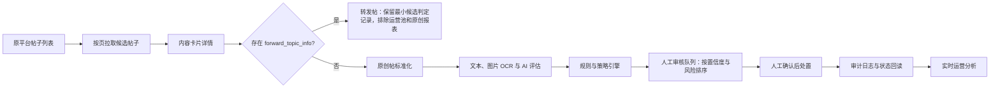

# 内容运营平台需求方案

版本：v0.2（需求与规划）  
日期：2026-07-18  
关联调研：[微信小游戏圈帖子管理：原创帖拉取调研](../research/wechat-game-circle-original-posts-research.md)

## 文档定位

本文描述产品目标和后续规划，不将规划功能表述为当前已交付能力。当前系统已实现原创/转发判定、断点采集、OCR/AI 异步评估、策略建议、内容管理工作台、人工确认的沉底/屏蔽/禁言/解除禁言/恢复正常、状态回读和操作审计、人工触发的小批量 AI 建议沉底/屏蔽，以及仅本地的回复草案工作台入口；策略管理界面、评论治理和人工 AI 反馈仍需后续交付。当前实现说明见[系统总览](../guides/system-overview.md)。

## 1. 背景与问题

现有游戏圈帖子管理后台存在以下运营瓶颈：

1. 列表中混有原创帖和“转发帖子 + 评论”内容，无法直接筛选原创帖，导致运营人员需大量人工甄别。
2. 每日帖子量大，运营人员需重复处理负面、引流、私服、外挂、人身攻击及与游戏圈无关的内容。
3. 原后台缺乏可执行的 AI 分级流程：高、低置信度内容均需要人工判断，但没有统一的审核队列、优先级和处置建议。
4. 运营数据需要人工汇总，无法快速得到指定日期范围内的原创帖数、内容类型分布、风险处置和互动表现等结果。

平台目标是在不改变原平台内容能力的前提下，建立“采集 -> 原创过滤 -> AI 评估 -> 策略决策 -> 人工处置 -> 审计与运营分析”的运营闭环。

## 2. 产品目标与边界

### 目标

- 只进入原创帖的运营池，转发帖及其评论链不参与日常审核和报表。
- 由内部 Scheduler Worker 定时触发新增原创帖采集与状态巡检，并提供实时运营分析。
- 所有内容均进入人工审核；AI 仅提供风险分级、建议动作和审核优先级。
- 提供可追溯的操作记录、人工最终处置和实时运营分析。
- 对反馈类、建议类帖子生成可编辑的运营回复建议，提升回应效率。
- 将内容审核规则、AI 模型版本与操作阈值配置化，而非散落在代码中。

### 非目标

- 首期不替代原平台的发布、编辑、话题和素材管理能力。
- 首期不批量采集评论正文，也不对评论单独做 AI 审核；帖子评论数仅作为运营指标。评论治理单列后续需求。
- 首期不直接存储浏览器 Cookie、会话令牌或完整后台请求 URL。
- 首期不允许系统自动执行原平台写操作；沉底、屏蔽、禁言和解除禁言均须人工确认，回复仅生成草案且不调用原平台发布接口。

## 3. 使用范围

首期不区分产品内角色和权限。所有已登录运营人员使用相同功能：查看原创帖子、查看 AI 建议、准备本地回复草案、人工执行处置和查看运营分析。

虽然不做角色区分，系统仍必须记录每次人工操作的执行账号、时间、动作、原因、AI 建议和原平台返回结果，以便追溯与复盘。

## 4. 核心业务定义

| 概念 | 定义 |
| --- | --- |
| 原创帖 | 内容卡片详情中 `forward_topic_info` 字段缺失或值为 `null` 的帖子。 |
| 转发帖 | 内容卡片详情中 `forward_topic_info` 字段存在且值不为 `null` 的“转发帖子 + 评论”内容。 |
| 沉底 | 将帖子降低展示优先级，不等同于屏蔽。对应原平台的帖子状态操作。 |
| 屏蔽 | 将帖子设为不可见/违规状态，需要记录违规原因。 |
| 禁言 | 对发帖账号设置禁止发言期限；已验证 1/3/7/30 天期限、原因位图与人工确认路径。 |
| AI 评估 | 模型输出的内容类别、风险标签、建议动作、置信度和可核验的证据。 |
| 建议动作 | AI 根据策略输出的沉底、屏蔽、禁言、保留等建议，不会自动执行。 |
| 人工审核 | 运营人员基于原帖、AI 证据和策略完成最终处置的队列任务。 |

## 5. 总体流程



### 当前运行时序

1. 内部 Scheduler 按北京时间每 15 分钟创建状态巡检和最近 30 分钟候选帖子采集任务；运营人员也可创建历史补采窗口。
2. 使用内容卡片详情判定原创/转发；转发帖仅保留最小候选判定记录，原创帖进入后续流程。
3. 标准化帖子正文、媒体、互动数据和来源状态；图片执行 OCR 后与正文共同送入 AI。
4. AI 输出结构化结果，规则引擎结合风险词、例外规则和置信度生成建议动作与审核优先级。
5. 所有记录均进入人工队列；高风险、高置信度内容置顶并标记为“优先处理”。
6. 对人工已执行操作回读帖子状态或操作日志，记录结果、失败原因和可撤销信息。
7. 运营人员在“运营分析”Tab 按北京时间日期范围和游戏实时查询聚合数据；需要最新互动数时，显式创建范围互动刷新任务。

## 6. 功能需求

### 6.1 数据接入与原创过滤

**FR-01 候选帖拉取**

- 系统应通过原平台的 `gettopiclist` 分页接口拉取候选帖子。
- 支持按发布日期窗口拉取，默认以“北京时间自然日”切分，避免全量扫描。
- 支持断点续跑：至少保存日期窗口、页码、最后处理时间、任务状态和失败记录。
- 以 `topic_id` 为业务主键，以 `content_id` 为内容卡片查询键；同一帖子重复出现时应幂等更新。

**FR-02 原创判定**

- 对每条候选帖调用 `getcontentcarddetail?need_comment=false`。
- `data.content_card.forward_topic_info` 字段存在且值不为 `null` 时，标记为 `FORWARD`，不进入运营池、不参与原创运营分析。
- 该字段缺失或值为 `null` 时，标记为 `ORIGINAL`，进入后续标准化与 AI 评估。
- 判定结果、判定时间和已脱敏的结构异常摘要应可追溯。
- 若 `content_id` 缺失、详情接口失败或结构异常，应标记为 `CLASSIFICATION_PENDING`，进入异常队列，不能默认当作原创帖处理。

**FR-03 数据标准化**

系统应保存最小必要帖子字段：

```json
{
  "topic_id": 0,
  "content_id": "",
  "origin_type": "ORIGINAL",
  "title": "",
  "content_html": "",
  "content_text": "",
  "images": [],
  "video_info": [],
  "publish_time": 0,
  "status": 0,
  "recommend_status": 0,
  "view_count": 0,
  "reply_count": 0,
  "love_count": 0,
  "share_count": 0,
  "source_appid": ""
}
```

- `content_html` 应转换为供 AI 和搜索使用的 `content_text`，保留必要换行和话题文本。
- 图片应保存受控的短期访问引用或业务允许的媒体 URL；OCR 文本须标记来源图片和置信度。
- 发帖者身份标识仅在执行禁言或解除禁言的请求内存中临时读取；不展示、不持久化，也不进入报表和普通检索索引。

### 6.2 AI 内容理解与分级

**FR-04 内容分类**

每条原创帖至少输出一个主类别，可附加次级标签：

| 类别 | 示例用途 |
| --- | --- |
| 攻略 | 玩法、阵容、资源、关卡、养成建议。 |
| 反馈 | Bug、体验、付费、数值、活动、客服反馈。 |
| 建议 | 玩法、活动、功能、运营或服务改进建议。 |
| 求助/问答 | 账号、玩法、任务、卡关求助。 |
| 活动/资讯 | 官方或玩家活动、版本信息、公告讨论。 |
| 晒图/社交 | 战力、抽卡、日常互动、非攻略分享。 |
| 无关内容 | 与游戏圈主题无明显关联的内容。 |
| 其他/无法判断 | 内容不足、图片不可读或模型无法稳定判断。 |

**FR-05 风险识别**

AI 应支持多标签风险判定，并给出命中的原文片段或 OCR 片段作为证据：

| 风险标签 | 默认建议动作 | 说明 |
| --- | --- | --- |
| 引流/外部联系方式 | 建议屏蔽 + 禁言 | 群号、联系方式、外链、交易或导流话术。 |
| 私服/盗版服务 | 建议屏蔽 + 禁言 | 宣传、招募、下载或交易私服。 |
| 外挂/作弊 | 建议屏蔽 + 禁言 | 销售、传播、求助或引导使用外挂。 |
| 人身攻击/辱骂 | 建议屏蔽 + 禁言 | 指向个人或群体的侮辱、攻击、威胁。 |
| 无关游戏圈内容 | 屏蔽或人工审核 | 与当前游戏无关的广告、闲聊、搬运等。 |
| 纯负面灌水 | 沉底或人工审核 | 无有效反馈、重复抱怨、恶意煽动。 |
| 有价值负面反馈 | 保留并标为“反馈” | 负面情绪不等于违规；含明确问题、复现信息或建议时不得仅因负面建议沉底。 |

**FR-06 结构化模型输出**

模型必须输出机器可校验的 JSON，禁止仅返回自然语言结论：

```json
{
  "content_category": "FEEDBACK",
  "secondary_categories": [],
  "risk_labels": [
    { "label": "TRAFFIC_DIVERSION", "confidence": 0.98, "evidence": ["..." ] }
  ],
  "sentiment": "NEGATIVE",
  "feedback_value": "LOW",
  "recommended_action": "BLOCK_AND_MUTE",
  "overall_confidence": 0.98,
  "needs_human_review": true,
  "reply_suggestion": null,
  "model_version": ""
}
```

- 每个风险标签应独立置信度，不能只使用单一总分。
- `evidence` 至少包含命中文本或对应图片 OCR 的定位信息；不能以模型解释替代证据。
- 所有帖子均须进入人工审核；当正文为空、图片 OCR 失败、文本存在讽刺/引用/反驳语境或模型输出不符合 JSON Schema 时，必须降低优先级可信度并标记为“需重点判断”。
- 风险词典、正则规则和模型结果应融合：规则命中可提高审核优先级，但不能单独绕过关键安全门槛。

**FR-06A 反馈与建议帖回复建议**

系统会持久化符合条件的模型本地草案，并在内容管理中仅为已有草案的帖子提供展示、编辑、复制和标记本地采纳能力；不提供人工 AI 正误反馈，也不提供原平台发布入口。

- 当主类别为 `FEEDBACK` 或 `SUGGESTION` 时，AI 应生成 `reply_suggestion`，包含用户诉求摘要、建议回复正文、需要补充的信息和回复风险提示。
- 回复建议应使用礼貌、克制、非承诺性的运营口吻：表达感谢、复述问题、说明已记录或建议的下一步；没有经过业务知识库核实的信息不得承诺修复时间、补偿、功能上线或处罚结果。
- 若帖子含辱骂、引流、私服、外挂或其他屏蔽/禁言建议，默认不生成公开回复，输出 `reply_suggestion=null` 和原因。
- 回复草案必须可编辑、复制和标记“已采用/未采用”；首期不调用原平台的发帖或评论接口自动发布回复。
- 平台应优先使用已审核的游戏 FAQ、活动规则、已发布公告作为回复依据，并在草案中标记引用来源；没有可靠依据时生成澄清问题而非编造答案。

建议输出结构：

```json
{
  "user_intent_summary": "",
  "reply_draft": "",
  "missing_information": [""],
  "knowledge_sources": [""],
  "risk_notice": ""
}
```

### 6.3 策略引擎与处置

**FR-07 策略配置**

策略应按“风险标签 + 置信度 + 例外条件 + 建议动作 + 审核优先级”配置，支持启用、停用、版本化和回滚。初始建议阈值如下，最终数值须由历史样本评测后确认：

| 情形 | 建议动作 | 初始策略 |
| --- | --- | --- |
| 有价值负面反馈 | 归类为反馈，不自动沉底 | 始终人工或保留。 |
| 纯负面灌水 | 建议沉底 | `overall_confidence >= 0.90` 时标记为高优先级人工审核。 |
| 无关游戏圈内容 | 建议屏蔽 | `risk_confidence >= 0.95` 且证据充分时标记为高优先级人工审核。 |
| 引流、私服、外挂、人身攻击 | 建议屏蔽 + 禁言 | `risk_confidence >= 0.98` 且有明确证据时标记为最高优先级人工审核。 |
| 多风险冲突或模型无法判断 | 人工审核 | 建议保留或人工判断，不写入原平台。 |

阈值不是固定业务规则。平台必须允许按游戏、运营活动、风险类别和模型版本分别配置，并记录每次命中的策略版本。

**FR-08 人工原平台操作编排**

- 系统不得自动调用沉底、屏蔽、禁言、恢复、标签、置顶、编辑或发布等原平台写接口。
- 运营人员在审核详情中确认后，才可调用已调研的原平台接口；调用前应再次验证目标仍为原创帖。
- 屏蔽操作必须带业务可读的原因码，并映射到已验证的 `block_info.reason` 位图。
- 禁言与解除禁言必须使用已验证的 `topicblockuser`、`topicunblockuser` 路径、原因位图和 1/3/7/30 天期限；仍须人工确认和状态回读。
- 系统对每个人工写操作须生成唯一 `operation_id`，以 `topic_id + action + confirmation_token` 做幂等键。相同确认令牌的重复点击或重试不得重复处置；运营人员在原平台恢复状态后重新确认同一动作必须可创建新的审计记录并再次执行。
- 写操作必须记录请求摘要、操作前状态、操作后状态、返回码、失败原因、执行者和执行时间；不得记录 Cookie、令牌或完整用户身份信息。
- 若原平台返回失败、会话失效或状态回读不一致，应标记为 `ACTION_FAILED` 并进入人工处理，不能无限重试。

**FR-09 人工审核队列**

审核页面应支持：

- 按风险等级、类型、置信度、创建时间、操作建议和处理状态筛选。
- 展示帖子正文、图片/OCR、互动数据、AI 标签、证据片段、模型版本和拟执行动作。
- 一键执行“跳过、沉底、屏蔽、禁言、屏蔽并禁言、解除禁言、恢复正常”及填写处理说明。
- 对屏蔽和沉底提供人工确认的恢复正常入口；原平台删除不提供手动恢复，只有管理详情重新成功时才清除本地删除状态位。
- AI 建议只用于队列排序和操作角标提示；不提供“AI 判断正确/错误”、人工标签或类别修正反馈。
- 高影响禁言、批量操作和策略变更应显示二次确认提示，并完整记录操作理由。

### 6.4 运营分析

**FR-10 范围运营分析**

运营分析默认统计窗口为最近 7 个北京时间自然日（含当天），支持在“运营分析”Tab 选择起止日期和游戏实时查询，单次范围最多 31 天；不生成快照、不导出文件，也不展示生成时间或预生成完整性状态。

| 指标分组 | 指标 |
| --- | --- |
| 数据接入 | 候选帖数、原创帖数、转发帖排除数、待判定数。 |
| 内容分布 | 攻略、反馈、建议、求助、活动、社交、无关、其他的数量和占比。 |
| 互动表现 | 浏览、点赞、评论、分享总量。 |
| 风险分布 | 引流、私服、外挂、人身攻击、无关、纯负面灌水等数量与占比。 |
| 处置结果 | 人工最终动作分布、待审核、已审核数。 |
| 回复建议 | 反馈/建议帖数、生成草案数、人工采用数、人工修改后采用数。 |
| 运营关注 | 当前范围内的内容类别、风险标签和人工最终处置分布。 |

- 每个帖子仅取最新互动快照参与总量计算；转发帖只计入转发排除数。
- 运营人员可显式为当前范围创建互动刷新任务。采集 Worker 异步回读原创帖浏览、点赞、评论和分享，只写本地互动快照；不刷新帖子内容、不触发 AI、不改变审核状态或原平台状态。
- 高互动排行、趋势、下钻、导出、AI 建议分布、AI/人工一致率和完整性标识属于后续能力。

## 7. 页面与用户流程

### 7.1 运营工作台

- 首页展示：今日新增原创帖、待审核数、高风险高置信度任务数、AI 建议数、接口失败数和昨日关键指标。
- 展示任务运行状态，包含最近成功时间、当前拉取窗口、队列积压和异常原因。

### 7.2 原创帖子库

- 默认仅展示 `origin_type=ORIGINAL`。
- 支持内容类别、风险标签、置信度、建议动作、审核状态和审核优先级排序筛选。
- 列表需标明“AI 建议”“审核优先级”和“最终处置”，避免把模型结论误认为人工最终结论。

### 7.3 审核详情

- 左侧展示帖子队列；详情顶部横向展示 AI 状态、重新评估、分类、置信度、优先级和建议动作，风险证据以内联折叠区展示；中间为正文、媒体和互动数据，右侧为悬浮人工处置卡。
- AI 建议仅高亮对应处置操作，绝不自动执行；已有草案时在风险依据后提供可折叠回复建议卡，草案可编辑、复制和标记本地采纳，绝不发布到原平台；不提供人工标签或 AI 正误反馈。
- 执行前显示目标 `topic_id`、具体动作、原因和影响说明，并要求二次确认。
- 写操作成功后立即回读状态并更新审计时间线。

### 7.4 策略管理

- 可维护风险类型、关键词/正则、AI 阈值、建议动作、例外词、审核优先级和策略版本。
- 策略发布前应支持历史样本回放，展示预计高优先级任务量、人工队列量和误伤风险。
- 策略变更需记录发布人、发布时间和回滚版本。

## 8. 数据模型

| 实体 | 核心字段 | 说明 |
| --- | --- | --- |
| `posts` | `topic_id`、`content_id`、`origin_type`、正文、媒体、互动数据、状态、发布时间 | 逻辑实体；实现中原创帖与候选帖分表，转发帖保留最小候选判定记录。 |
| `ai_assessments` | `topic_id`、类别、风险标签、置信度、证据、模型版本、评估时间 | 同一帖子可保留多次评估，用于模型对比。 |
| `moderation_tasks` | `topic_id`、建议动作、优先级、状态、负责人、到期时间 | 人工审核队列。 |
| `operations` | `operation_id`、`topic_id`、动作、原因码、策略版本、前后状态、结果码、执行者 | 所有人工写操作的审计表。 |
| 无运营分析持久化表 | 运营分析直接读取候选帖、原创帖、互动快照和审核任务 | 当前不生成运营分析快照、CSV 或预计算聚合记录。 |
| `policies` | 风险类型、阈值、例外条件、建议动作、优先级、版本、启用状态 | 策略中心配置。 |

## 9. 非功能与安全要求

### 可用性与可靠性

- 拉取、AI 评估、状态巡检和范围互动刷新应拆为可重试的异步任务；运营分析查询实时聚合，不生成报表任务。
- 所有外部接口调用需限速、指数退避、幂等处理和失败告警。
- 令牌过期或登录失效时停止写操作并告警，不能用过期凭据重试。
- 关键任务应支持人工重跑指定日期窗口，不影响已完成记录。

### 数据与隐私

- 会话令牌、Cookie、运营者 `openid` 仅存在于受控运行时密钥存储，禁止进入前端、日志、报表和数据库业务字段。
- 评论正文及评论者身份不属于首期常规数据采集范围。
- 审核证据、媒体和用户标识应设置最短保留期限与访问控制。
- 当前运营分析仅提供页面内聚合查询；导出能力属于后续规划，若实现单帖明细导出应留下审计记录。

### 可解释与可审计

- 每次 AI 判断必须记录模型版本、提示词/策略版本、置信度和证据。
- 每次人工处置必须能够回答：处理了哪个帖子、AI 建议依据哪条策略、AI 给出什么证据、人工为何确认该动作、调用结果如何、如何恢复。
- 任何人工覆盖必须记录最终动作与理由，作为后续评测样本。

## 10. 分期交付

### Phase 1：原创帖数据底座与运营分析

- 原创/转发判定、增量拉取、帖子标准化、互动数据采集。
- 原创帖子库与基础筛选。
- 北京时间日期范围的原创帖数、类型聚合和互动聚合。
- 不执行任何自动写操作。

### Phase 2：AI 评估与人工审核

- 文本 + 图片 OCR 分类、风险识别、证据展示和置信度分层。
- 人工审核队列、操作日志、风险证据与 AI 建议辅助。
- 人工 AI 反馈与人工标签不纳入当前阶段，后续独立评审；回复草案工作台入口只支持本地准备，不包含原平台回复发布。
- 默认所有写操作由人工触发。

### Phase 3：人工处置辅助优化

- 在现有禁言与解除禁言能力上，补充更精细的优先级排序、批量审核辅助、操作前状态回读与策略回放。
- 支持策略回放、人工结果抽检和回滚。

### Phase 4：持续优化

- 评论治理、账号风险历史、模型质量看板、趋势预警、跨游戏策略复用。
- 根据抽样审核结果、处置审计和策略版本持续校准分类、风险阈值和例外规则。

## 11. 验收标准

### 原创过滤

- 给定原创样本 `1412250588`，系统应标记为 `ORIGINAL` 并进入帖子库。
- 给定转发样本 `1412251815`，系统应标记为 `FORWARD` 且不计入原创运营分析。
- 详情接口异常的帖子不得进入人工处置流程。

### AI 与审核

- 每条已评估原创帖必须有类别、风险标签、置信度、建议动作和证据。
- 所有记录必须进入人工审核；高置信度、高风险记录应排在队列前列。
- 人工操作记录必须可追溯到具体策略版本、模型结果和原平台返回结果。
- AI 建议必须始终保持人工确认边界，不得触发任何原平台自动写操作。

### 处置与运营分析

- 沉底、屏蔽、禁言等写操作必须由人工确认，并按二次确认和幂等规则执行。
- 任何写操作失败都必须进入异常队列且不重复造成副作用。
- 运营分析必须分别展示原创帖数、转发排除数、类型分布、风险分布、互动数据和处置结果。
- 运营分析实时读取已采集数据；范围互动刷新任务的未完成或失败样本通过后台任务状态与 checkpoint 查看，不在分析页生成完整性标识。

## 12. 待确认事项

1. “纯负面灌水”与“有价值负面反馈”的运营边界、具体示例和最终处置规则。
2. 各风险类别对应的原平台 `block_info.reason` 枚举值及禁言时长规则。
3. 禁言和解除禁言的限流、上游幂等与异常响应边界。
4. 原平台私有接口的稳定性、允许调用方式、账号授权范围与合规要求。
5. 高置信度阈值的最终数值，需要用已人工标注的历史帖子评测后确定，并只用于审核优先级与建议动作，不用于自动处置。
6. 图片 OCR、视频内容识别的成本、时延和允许处理范围。
7. 多游戏自动采集的频率、允许的任务运行时间及未来分析结果发送渠道。
