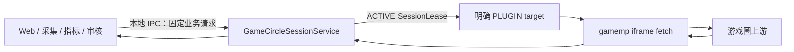

# 游戏圈唯一会话服务方案

## 目标

游戏圈来源请求依赖受控 Chrome 的外层会话、明确的插件 tab 和 `binduseridentity` 产生的来源身份 token。来源身份 token 不能持久化；外层 token 失效后，新的 Worker 不能可靠地重新绑定，但已经持有旧 token 的已验证插件可能仍可短时完成只读请求。

因此，系统将所有 CDP 与 token 生命周期收敛到唯一、常驻的 `GameCircleSessionService`。它不是每个 Worker 各自实例化的工具类；Web、采集、指标和审核只提交类型化业务请求，不接触 target 或 token。

## 调用链



调用方只能传递 execution scope、固定来源方法、业务参数和已确认写操作的 `operation_id`。Web 的“去登录”同样只能提交固定 `OPEN_CONTROLLED_LOGIN` 请求，由会话服务打开受控 Chrome 的固定无认证登录页。IPC 禁止任意 CDP 命令、JavaScript、URL、target ID、路径和认证材料；接口仅本机可达，且不记录认证信息或原始上游响应。

## SessionLease

会话服务内存使用按 AppID 排序的会话队列：

```text
appid -> [ACTIVE lease2, RETIRING lease1, ...]
```

一个 `SessionLease` 原子包含：

```text
lease_id, appid, browser_generation,
home_target_id, plugin_target_id, plugin_generation,
source_token, issued_at,
state, retire_not_before_at, active_accesses
```

`source_token` 与关联 tab 不能拆成独立、可由其他进程重新取得的 lease。它只在会话服务内存存在；新进程在外层 token 已失效时无法凭空重新绑定。每个 AppID 恰有一个 ACTIVE lease，旧版本在新版本成功发布后转为 RETIRING；列表允许临时超过两个元素，避免连续刷新提前关闭仍在使用的 target。

当前业务仍只允许一个 `ActiveGameScope`。按 AppID 的数据结构只为未来多游戏并行预留；在受控多游戏只读验证通过前，不得解除该业务约束。

## Target 所有权

会话服务只清理自己创建且登记为 owned 的 target。登记记录只含 target ID、service owner epoch、角色和关联 lease/probe，不含认证材料。不得通过域名、标题、URL、页面文字或页面列表顺序推断所有权。

- 刷新 candidate 验证失败：只关闭本次 `HOME_CANDIDATE` / `PLUGIN_CANDIDATE`。
- 已发布 lease：其 `LEASE_HOME` / `LEASE_PLUGIN` 只在退役条件满足后关闭。
- 登录探测：完成后关闭 `PROBE_CANDIDATE`。
- Web 请求创建的 `LOGIN_PAGE`：扫码期间保留；仅在后续已验证会话明确替代后回收。

用户直接在 Chrome 手动打开、复制或保留的 tab 均为未知 target，即使同域也永不接管、关闭或作为来源请求目标。手动关闭 owned target 时，服务只能将其视为 target 丢失并走 RECOVER，不能寻找相似手动 tab 替代。

## 请求与回收

每个来源请求在服务内原子取得 ACTIVE lease，并创建唯一 `SessionAccess`。Access 在 finally 中释放；超时先取消对应 CDP 请求再释放。展示用的请求数由 Access 集合长度派生，不能依靠可遗漏的整数加减。

新请求永远使用 ACTIVE lease；已经取得旧 lease 的请求可完成。旧 lease 必须同时满足以下条件才会关闭它拥有的 HOME/PLUGIN target：

```text
state = RETIRING
当前时间 >= retire_not_before_at
active_accesses 为空
```

RETIRING lease 不允许重新绑定。若旧请求收到 `errcode=-2`，幂等只读操作可重新请求 ACTIVE lease；人工写操作必须返回重新确认，绝不自动重放。

## 刷新

同一 AppID 同时只有一个 candidate 构建流程；相同范围、相同模式的刷新请求合并。刷新服务创建并验证 HOME candidate，读取 outer token、按模式对齐当前游戏、创建 PLUGIN candidate、调用 `binduseridentity` 并做最小只读验证。`RECOVER` 当前为目标时直接重建，当前不为目标时只直接切到目标；`KEEPALIVE` 当前为目标时必须受控执行 `A → B → A`，当前不为目标时只直接切到目标。B 从已获平台许可的非目标目录项中去重、稳定排序后随机选择；中转失败不能降级。不同模式的活动 Job 不互相复用，以保留各自的切换语义；会话服务仍按同一 AppID 单飞构建 candidate。只有全部成功后才原子发布新 ACTIVE lease；失败只清理 candidate，保留旧 ACTIVE lease。

刷新产生新 lease 后，旧 lease 进入 RETIRING，而不是立即关闭。这样已开始请求可以继续使用其已有的 `source_token` 和 PLUGIN；随后新请求改走新 lease。

`errcode=-2` 只允许在 ACTIVE lease 且关联 HOME 仍可验证 outer token 时重绑一次；其他情况进入 RECOVER。`errcode=1`、限流、5xx、权限、契约和普通业务错误不应误触发登录恢复。

## 服务重启与人工写操作

会话服务进程重启会清空其所有 token 与 SessionAccess。新 owner epoch 不得复用旧 lease；它必须重新探测外层会话并建立新 lease，或在明确扫码时写入脱敏状态。这是拒绝持久化认证材料的安全代价。

人工写操作在发送前拥有固定 `operation_id`。若服务在上游写入后、返回前中断，系统只能将操作标为“待回读确认”；不得因为连接中断再次发送同一写请求。

## 验证门槛

所有验证先使用受控 Chrome 与只读样本：并发读取期间发布新 lease、RETIRING target 延迟关闭、异常/取消/超时释放 Access、单飞绑定、服务重启、`errcode=-2` 分类，以及 A/B 游戏并发只读兼容性。多游戏并行和任何真实上游写操作都不得作为首次验证手段。
