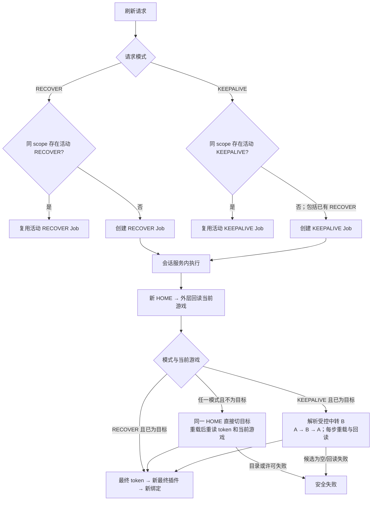

## Context and verified facts

本变更续接已授权 Chrome 中的外层公众平台会话，不是扫码自动化。完整调研记录见 `docs/research/wechat-game-circle-session-refresh-research.md`；本文只引用已脱敏结论。

| 会话层 | 作用 | 生命周期与保存规则 |
| --- | --- | --- |
| 浏览器 Cookie 会话 | 维持已登录的公众平台浏览器状态 | 仅由受控 Chrome 管理；系统不读取、导出或持久化。 |
| 外层 URL token | 当前外层页的运行时 token，用于创建插件页 | 仅在一次协调器刷新调用内存中使用；每次新 HOME 均重新读取。 |
| 插件上下文 | 由固定 `pluginRedirect` 路由和外层 token 创建的 `gamemp` iframe | 与明确 `PLUGIN` target 和 generation 绑定；替换后旧上下文失效。 |
| 来源身份 token | `binduseridentity(appid)` 的返回值 | 只存在于唯一会话服务内存；与取得它的 HOME/PLUGIN target 和 generation 作为同一会话 lease 存活，绝不持久化。 |

受控实测确认：外层 URL token 失效时最终插件 iframe 不会创建；旧来源身份 token 在 Cookie 会话仍有效时可能短时可读，但不能补回丢失的 iframe。无论 `RECOVER` 还是 `KEEPALIVE`，均新建 HOME 和最终 PLUGIN，以新的 token、身份绑定和最小只读验证原子替换 lease。两者的游戏对齐策略不同：`RECOVER` 仅在当前游戏不等于执行范围时直接切到目标；`KEEPALIVE` 在当前已为目标时必须执行受控 `A → B → A`，并在每步稳定后重新读取 token 与当前游戏。

受控实测已确认当前游戏的稳定外部回读契约：在明确 HOME target 的 `mp.weixin.qq.com` 外层页面中，以绝对 URL `https://gamemp.weixin.qq.com/cgi-bin/gamewxagsettingwap/getappinfo` 和浏览器凭据发起请求；HTTP 200 且业务 `errcode=0` 时，当前 AppID 位于 `data.app_info.appid`。相对路径会错误落到 `mp.weixin.qq.com` 并返回 404，不得使用。直接切换或保活中转后的每一步都必须使用此契约回读。中转游戏从平台许可的非目标目录项中均匀随机选择，候选先去重和稳定排序，且不得依赖上游列表顺序。调研时的“当前登录”面板标记只用于交叉核验，不得进入生产逻辑。

### Production path gate

`read_current_game()` 的实际请求和成功结构已经完成受控验证。生产路径只接受绝对 `getappinfo` 的 HTTP 200、`errcode=0` 和非空 AppID；`RECOVER` 或当前不在目标的 `KEEPALIVE` 只可确认目标唯一、许可通过后直接切到目标一次。当前已在目标的 `KEEPALIVE` 必须从可切换的非目标目录项中均匀随机选择中转 B，再依次切至 B、回读 token/当前游戏，随后切回目标并再次回读。候选为空、请求失败、结构无效、目录/许可/中转不满足或任一步回读不一致时均不得发布 lease，且不得退化为 `RECOVER`、回退到 DOM、列表顺序或临时 iframe。

HOME 的 URL 到达 `mp.weixin.qq.com` 只表示导航完成，并不代表跨站 `getappinfo` 已可读。刷新在读取 outer token 后必须有界轮询该实际契约，成功得到 AppID 才进入切换或 PLUGIN 创建；切换后也复用同一等待原语。候选失败依旧由刷新 `finally` 关闭，因而短暂打开后关闭是候选失败的预期清理结果，而不是可复用会话被回收。

固定插件路由不可变，只有 token 在内存中替换：

```text
https://mp.weixin.qq.com/wxamp/frame/pluginRedirect/pluginRedirect
  ?title=&action=plugin_redirect&token={runtime_token}&lang=zh_CN
  &plugin_uin=1029&simple=1&nosidebar=1
  &custom=path%3D%2Fminigame%40community%2Fminigame%2Fpage%2Fhome
```

## Architecture

### Scope and job ownership

`ActiveGameScope` 是唯一当前操作游戏配置，只保存 `active_appid`、单调递增 `scope_version`、更新时间和本地操作者。AppID 必须属于 `ManagedGame`；目录同步后若配置为空，可由部署配置中的默认游戏初始化，但业务 AppID 不得写进代码、迁移、Worker 或 Scheduler。

所有访问游戏圈的 Job 在入队时不固化范围。Worker 首次准备连接 CDP 时，在事务中解析：

1. 若 checkpoint 有 `execution_scope`，验证其结构后直接使用；
2. 否则读取 `ActiveGameScope`，写入 `{target_appid, scope_version}`；
3. 之后的重试、分页、来源触发刷新都只使用该不可变快照。

因此，尚未开始的 Job 使用新配置，已经开始的 Job 不被配置切换改写。人工补采、状态、互动、作者处置和受控操作必须与当前操作游戏一致；兼容入口带入的 AppID 不一致时在服务端拒绝。切换配置只创建或复用一个未解析或同范围的刷新 Job，不在 Web 请求中执行会话生命周期操作。

### Scheduler time-slot admission

Scheduler 的循环频率不是业务时间槽。登录探测的五分钟槽和 `KEEPALIVE` 的六个北京时间槽都以 `task_type + scope（如有）+ Asia/Shanghai 时间槽` 作为稳定幂等键，并通过数据库原子 `get_or_create` 入队；同一槽的 Job 即使已完成或失败，也只表示该槽已经尝试，不得因同一分钟的第二轮 Scheduler 轮询再次创建。`RECOVER`、人工探测与人工保活不共享该时间槽键，仍按各自的活动 Job 复用语义执行。

### IPC caller capability

loopback 只限制网络路径，不能表达调用方身份。Supervisor 在启动子服务前生成或读取独立的游戏圈 IPC capability，并只通过子进程环境注入；它不写入数据库、Job、日志、运行态或 HTTP 响应，也不复用 Supervisor 控制通道 token。每个 IPC 请求先携带该 capability，服务端在反序列化后的固定大小值上以恒定时间比较；失败时立即返回固定“未授权”结果，且不得构造 `IpcRequest`、解析业务参数或调用 CDP。能力值不进入请求对象、异常、日志或测试输出。

这使无运行时进程能力的本机进程不能调用高风险上游写。与所有同一操作系统账户内的本地 capability 机制一样，它不替代主机账户隔离；部署文档必须要求使用 Supervisor 启动整套服务，并限制运行时目录与进程环境的访问。

### 外层登录态探测与脱敏运行态

游戏目录不属于会话生命周期。本变更**不**将 `ManagedGame` 目录同步改为定时任务、运行态或新的 Worker 流程；它继续保留为管理员显式发起的一次性目录同步功能。下面的运行态只回答“受控 Chrome 的外层微信会话此刻是否可用于后续会话刷新”，不表达游戏目录、当前操作游戏、插件或来源身份是否可用。

现有 `/auth/status` 和配置台 context processor 会在 Django 请求内创建临时 HOME target、读取页面并关闭 target。这既使每个页面访问触碰 CDP，也会与 Worker 的 target/锁边界竞争。改造后，Django 请求只读取本地、脱敏的 `GameCircleLoginRuntimeState` 单例；不得为展示、轮询或配置页渲染连接 CDP。

该运行态是有明确字段和枚举的持久模型，而非自由 JSON：

```text
login_state: READY | SCAN_REQUIRED | UNAVAILABLE | UNKNOWN
checked_at: 最近一次完成探测的时间
last_ready_at: 最近一次确认 READY 的时间（可空）
error_category: NONE | SCAN_REQUIRED | CHROME_UNAVAILABLE | OUTER_SESSION_UNREADY | PROBE_FAILED
updated_at: 本地运行态写入时间
```

它不得保存 token、Cookie、二维码、完整 URL、页面标题、页面文本、账号标识、游戏展示名或任何上游原始响应。页面可展示的原因文案必须由 `login_state` 与 `error_category` 的固定映射产生，不能直接呈现异常原文。若 `checked_at` 超过十分钟，Web 必须将其显示为 `UNKNOWN`（“状态待检查”），即使最后持久化状态为 `READY` 也不得继续宣称已登录。

新增无 scope、无认证参数的 `GAME_CIRCLE_LOGIN_PROBE` Job，并由唯一的 `game_circle_session` 会话服务专职消费。它不要求当前操作游戏，也不使用或改变现有 AppID 会话 lease：

1. Scheduler 每五分钟按时间槽创建或复用一个探测 Job；`game_circle_session` Worker 启动后也补入一次。入队仅写非认证性的时间槽/请求来源，且同一活动探测 Job 必须复用。
2. 会话服务创建**本次所有**的 HOME candidate，访问固定 `https://mp.weixin.qq.com/`，仅投影三类结果：明确扫码提示、外层 token 是否存在、或 CDP 不可用。它不记录 token 本身。
3. candidate 只由本次探测关闭；未知 tab、已登记 HOME/PLUGIN 和现有 lease 均不得被接管、关闭、替换或失效。受控 Chrome 已由 Supervisor 管理，关闭 owned candidate 可以使浏览器暂时零 tab。
4. 明确扫码提示写入 `SCAN_REQUIRED`；存在外层 token 写入 `READY`；Chrome 不可用写入 `UNAVAILABLE`；其余协议、页面或调用异常写入 `UNKNOWN`。每种结果均更新 `checked_at`，只有 `READY` 更新 `last_ready_at`。

`GAME_CIRCLE_SESSION_REFRESH` 的结果可复用这份事实，但不取代其更强的游戏会话验证：刷新成功可写入 `READY`；其已确认的“需要人工扫码”直接失败可写入 `SCAN_REQUIRED`；Chrome 不可用可写入 `UNAVAILABLE`。来源 Worker 的普通来源请求失败不得写入该状态，避免把插件、业务权限或单次网络问题误报为外层登录失效。

前端顶部状态条仍可在首次加载、获得焦点和每 30 秒请求 `/auth/status`，但该路由只读取上述运行态并返回固定脱敏字段，绝不连接 CDP。配置台首页也只读取同一状态。状态不是 `READY` 时，只有 `SCAN_REQUIRED` 可显示“需扫码登录”并接受经认证用户显式 POST；Web 只能向会话服务提交固定的 `OPEN_CONTROLLED_LOGIN` IPC 请求。会话服务仅可在受控 Chrome 打开固定公众平台登录页 `https://mp.weixin.qq.com/cgi-bin/loginpage` 供人工扫码；无运行时 token 的 `pluginRedirect` 路由绝不作为登录页。`UNAVAILABLE` 与 `UNKNOWN` 只显示对应状态，不得伪装为“去登录”。Web 不读取登录信息、不登记 target，也不创建或接管会话。扫码后“重新检查登录态”同样仅向会话服务入队/复用 `GAME_CIRCLE_LOGIN_PROBE` 并提示稍后刷新；不会在 HTTP 请求内验证扫码结果。

顶部必须分别投影两个状态，避免把外层登录误解为可执行来源操作：`会话有效` 只表示 `GameCircleLoginRuntimeState.READY` 的受控微信外层 HOME/token 可用；`Frame 有效` 只表示当前 `ActiveGameScope` 在本地脱敏 session projection 中存在 `ACTIVE` lease，且会话服务心跳在一分钟内。Frame 状态只读 `runtime/supervisor` 下的 lease 投影与心跳，不读取 token、不调用 Supervisor 控制接口、更不连接 CDP。会话服务启动时必须立即覆写空 lease 投影，停止接收请求时也必须清空投影，防止前一 owner 的遗留文件被当作可用 Frame。

外层状态不属于 Frame 恢复：人工“检查外层会话”只创建无 scope 的 `GAME_CIRCLE_LOGIN_PROBE`。当前游戏已配置、会话服务在线但 Frame 为 `NOT_READY` 时，顶部 Frame 胶囊可由已认证用户以固定 CSRF POST 创建/复用当前 scope 的 `RECOVER` Job；Web 只入队，不创建页面或调用 CDP。操作结果必须说明“已创建/复用 Frame 恢复任务”，而不是承诺同步打开页面。系统配置运行节点 2“当前操作游戏”集中提供切换游戏、保活、外层会话检查与目录同步；切换游戏与“打开当前游戏 Frame”创建或复用同 scope 的 `RECOVER`，不改写已保存范围；“保活 Frame”创建或复用同 scope 的 `KEEPALIVE`。二者共享候选、绑定和发布边界，但不共享游戏切换策略。

### 唯一会话服务、SessionLease 与 SessionAccess

`game_circle_session` 是唯一的 `GameCircleSessionService` 宿主，而非仅消费刷新 Job 的普通 Worker。它是唯一能创建、扫描、接管或关闭系统 target，读取 outer token，调用 `binduseridentity`，以及在 `gamemp` iframe 内携带来源身份 token 发起请求的进程。Web、采集、指标、AI 审核和一次性 Job 不得创建协调器实例、CDP client、frame 或来源身份 token；它们仅通过固定、类型化、仅本机可达的 IPC 契约提交非认证请求描述，并接收临时来源 payload 或脱敏结果。

来源详情读取的失败诊断也保持在该边界内。CDP 适配器可将响应投影为 HTTP 状态、是否重定向、是否声明 JSON 和是否成功解析 JSON；这些仅用于选择固定错误分类。IPC、`OperationAudit` 和运行日志不得保存或展示响应正文、最终 URL、认证信息或上游异常文本。写前读取失败必须以该固定分类留痕，不能被笼统伪装为写入失败，也不得因诊断重试或发送写请求。

会话服务在**自身内存**维护下列完整 `SessionLease`，而不是将 target 生命周期和来源身份 token 拆成可独立取得的对象：

```text
{ lease_id, appid, browser_generation, home_target_id, plugin_target_id,
  plugin_generation, source_token, issued_at,
  state: ACTIVE | RETIRING, retire_not_before_at, active_accesses }
```

其中 `active_accesses` 是 `access_id -> {started_at, deadline}` 的内存集合；展示的 `active_request_count` 只能由其长度派生，不能作为单独可增减的真相。每个 AppID 维护有序 lease 队列：恰好一个 `ACTIVE`，以及零到多个 `RETIRING`。虽然当前业务仍只有一个 `ActiveGameScope`，该结构为未来经受控验证后的多游戏并行预留；本变更不得因此解除单 scope 的业务约束。

取得请求会话的步骤必须在服务内短暂原子化：选择当前 `ACTIVE` lease、创建 `access_id` 并写入其 `active_accesses`，然后把不可变 lease 快照用于一次 iframe 请求。`SessionAccess` 同时保存单调截止时间、取消标记和本次创建的 frame 集合；所有来源/重绑 frame 都必须经 Access 的 deadline wrapper 执行，每次 CDP 调用只可使用剩余时限。请求成功、异常、超时或取消都必须先关闭已登记 frame，再在 `finally` 中删除相同 `access_id`；超时不得只是展示字段。服务停止时先拒绝新请求，再有界等待或取消旧请求。进程崩溃会丢失所有 token 和 Access；新 owner epoch 必须把旧系统 lease 视为不可用，且人工写操作若未收到确定结果只能进入“待回读确认”，不得重放。

新请求只可取得 `ACTIVE` lease；已经持有 `RETIRING` lease 的请求可完成，但它收到 `errcode=-2` 时不得对退役 PLUGIN 重绑。幂等只读调用可以重新向服务请求当前 `ACTIVE` lease；人工写操作返回需要重新确认。对 `ACTIVE` lease 的 `-2`，服务只在关联 HOME 仍可验证外层 token 时尝试一次绑定；否则创建/复用 `RECOVER`。`errcode=1` 与未经验证的业务码不得触发刷新。

系统只在 `RETIRING` lease 已超过 `retire_not_before_at` 且 `active_accesses` 为空后，关闭该 lease 所拥有的 HOME/PLUGIN target 并移除它。candidate 失败只关闭 candidate；未知 tab 永不接管、关闭或作为回收对象。若连续刷新产生 lease3，lease1/lease2 在仍有 Access 时必须继续保留，不能为了限制列表长度提前关闭。

服务对同一 `{appid, lease_id}` 的绑定使用细粒度单飞协调，避免多个并发请求重复 `binduseridentity` 并可能互相使 token 失效。普通来源请求的并发上限当前为不设限，但服务 SHALL 保留按 AppID/lease 配置并发与速率控制的字段；是否允许同一来源身份 token 的长期并行请求必须先由受控只读验证确认。

脱敏运行态只可投影 browser generation、服务 owner epoch、AppID、lease generation、ACTIVE/RETIRING 状态、安全计数和固定失败类别；不得保存 `source_token`、outer token、完整 URL 或 Cookie。浏览器 generation 改变时，服务必须使所有 AppID lease 同时失效，且不得再对旧 target 发请求。

### Target 所有权与清理

会话服务只可清理其**自行创建且已登记为 owned** 的 target。所有权以 target ID、service owner epoch、角色和关联 lease/probe 标识记录；不得通过域名、标题、URL、页面文字或 `/json/list` 顺序推断所有权。用户在受控 Chrome 中手动打开的 tab，即使同域或看似插件页，也属于未知 target：服务不得接管、选择、关闭或把它作为来源请求目标。

owned target 的角色和回收规则如下：

| 角色 | 创建者 | 回收规则 |
| --- | --- | --- |
| `HOME_CANDIDATE` / `PLUGIN_CANDIDATE` | 刷新流程 | 验证失败时仅清理本次 candidate；成功后升级为关联 lease 的 target；允许回收至零 tab。 |
| `LEASE_HOME` / `LEASE_PLUGIN` | 成功发布的 SessionLease | 仅在关联 lease 为 RETIRING、过最早退役时间且 SessionAccess 归零后清理。 |
| `PROBE_CANDIDATE` | 登录态探测 | 探测完成后清理，允许回收至零 tab。 |
| `LOGIN_PAGE` | `OPEN_CONTROLLED_LOGIN` | 扫码期间不得清理；仅在当前 owner 成功发布后续已验证会话后回收。 |
| `CATALOG_CANDIDATE` | 显式目录同步 | 读取目录后立即关闭；同样仅由会话服务登记和清理。 |

用户手动关闭 owned target 时，服务在下一次使用或回读时将其分类为 target 丢失并走 RECOVER；不得通过寻找相似手动 tab 进行替代。服务重启后旧 owner epoch 的 owned target 不得复用，新的服务只可根据非认证性登记做安全清理或重新建立 candidate，未知 tab 始终保留。

会话服务停止时，应先拒绝新请求、取消 Access，并关闭当前 owner 登记的 `HOME_CANDIDATE`、`PLUGIN_CANDIDATE`、`LEASE_HOME`、`LEASE_PLUGIN`、`PROBE_CANDIDATE` 与 `CATALOG_CANDIDATE` target；`LOGIN_PAGE` 供人工扫码，不在此关闭范围。Supervisor 的 Windows 强制终止可能跳过进程 finally，因此启动新 owner 时还必须在创建任何新 HOME 前读取上一份脱敏 projection：仅当其中 browser generation 与当前受控 Chrome 一致，才按登记的 target ID 清理上述旧 owner target。关闭失败但 target 仍存在时必须保留 orphan 登记，供后续同步 generation 时重试；generation 不一致则旧 target 已随浏览器失效。不得根据 URL、域名或页面列表关闭任何未登记 tab。

## Refresh state machine

`GAME_CIRCLE_SESSION_REFRESH` 是会话服务的续接 Job。Job 参数只保存非认证性 `refresh_mode`：Scheduler 和人工“保活 Frame”创建 `KEEPALIVE`；切换当前操作游戏与会话服务检测当前 ACTIVE lease 不可用时创建 `RECOVER`，后者复制来源 Job 的既有 `execution_scope`。完成和失败 Job 绝不复用。

准入按 AppID/scope 和模式分别复用：`RECOVER` 只复用同 scope 的活动 `RECOVER`，`KEEPALIVE` 只复用同 scope 的活动 `KEEPALIVE`。两种 Job 的切换语义不同，不得因为都能产出插件而相互合并；当另一模式正在活动时，创建本模式的待执行 Job。每个 AppID 同时至多一个实际 candidate 构建流程；会话服务按该 AppID 顺序执行不同模式的 Job，避免 lease 列表因刷新风暴无界增长。



Scheduler 在北京时间 `03:10`、`07:10`、`11:10`、`15:10`、`19:10`、`23:10` 创建带时间槽幂等键的刷新 Job。Scheduler 不连接 CDP，前一次失败不阻止下一槽重新探测。

`RECOVER` 由插件/target/lease 失效、来源请求要求续接或 Chrome 重启后触发；`KEEPALIVE` 由定时或人工刷新触发。两者均以新 HOME 和新最终插件重建会话：`RECOVER` 当前为目标时不切换、否则只直接切目标；`KEEPALIVE` 当前为目标时从平台许可的非目标目录项中均匀随机选择 B 往返，当前不为目标时只直接切目标。候选为空时安全失败。两种模式均只能由会话服务执行；它们与普通来源请求通过 SessionAccess 生命周期协调，而不是以跨 Worker 全局互斥锁串行化。

会话服务构建新 candidate 的精确步骤：

1. 解析/复用 `execution_scope`，取得 `target_appid`；创建新的 HOME candidate，不先关闭旧 target。
2. 在 HOME 判定扫码页并读取运行时 token。若显示扫码或无 token，直接终止当前刷新 Job，脱敏原因为“需要人工扫码”。
3. 在 HOME 外层通过绝对 gamemp 请求回读当前 AppID。`RECOVER` 当前不为目标时仅在目录唯一包含目标且平台许可时直接切目标；`KEEPALIVE` 当前不为目标也只直接切目标，当前为目标则从非目标可切换目录项中随机选择 B 并执行 `A → B → A`。每次切换均必须等待同一 HOME 重载，重新读取 token 和当前 AppID。候选为空、目录/许可、切换或任一步回读不满足时失败，且 `KEEPALIVE` 不得降级为 `RECOVER`。该调用只生成调用期投影；不得更新 `ManagedGame` 或持久化展示字段。
4. 使用最终 HOME token 创建固定插件路由 candidate。确认 iframe 已连续稳定且没有登录超时/重新登录提示。
5. 递增 plugin generation，主动 `binduseridentity(target_appid)`，建立完整的候选 `SessionLease`；再做一个最小只读来源验证。绑定或验证失败时丢弃 candidate，保留旧 ACTIVE lease。
6. 原子发布新的 ACTIVE lease，并将旧 ACTIVE 标记为 RETIRING；不得立即关闭旧 target。只有满足 lease 回收条件时才关闭明确被替代的系统 target。刷新 Job 成功。

新首页扫码/无 token，以及目录缺少目标、目标不唯一、保活中转候选为空或平台不允许切换，是直接失败。Chrome 进程重启、响应契约错误、当前项无法回读、切换后重载/回读失败、插件验证失败和其他普通错误使用既有有限指数退避。一个 Job 用尽自身既有 retry 后可以失败；这不改变 Scheduler 的后续时间槽，后续 Job 仍独立重新探测。系统不得维护连续失败计数、保活状态或 `WAITING_FOR_SCAN` 等持久 Job 状态。

### Source-job interaction

调用方通过本地 IPC 向会话服务提交来源请求。服务遇到明确插件失效时创建或复用刷新 Job；调用方保留 checkpoint，并仅在刷新 Job 仍为活动状态时 `JobDeferred`，不消耗来源业务 retry。直接失败的刷新 Job 使来源 Job 用相同脱敏原因终止；刷新 Job 耗尽普通 retry 后，来源 Job 走自身有限 retry。网络、限流、5xx、权限、契约和普通业务异常不触发刷新。已确认的有界人工上游操作（单条，或最多 20 条的沉底/屏蔽批量）提交固定 `operation_id`；若会话不可用，服务返回脱敏的“稍后重新确认”。恢复成功后绝不自动重放。若服务在上游写入后、返回前中断，调用方必须标为待回读确认，不得以相同操作再次发送写请求。

`STATUS_SYNC` 只有当本批所有选中的帖子都完成来源回读，或被来源明确确认已删除时才可成功。任务必须在每次结束时写入不含上游数据的 `attempted`、`refreshed`、`failed` 和 `limit` 检查点；无选中帖子以 `attempted=0` 正常成功。若任意来源读取、指标保存或契约处理未完成，任务可继续尝试其余帖子，但最终必须抛出安全来源错误并进入既有有限 retry，不得因吞掉异常而写成 `SUCCEEDED`。

已登记 target/iframe 丢失（包括 browser generation 改变后旧 target 不存在）是明确会话失效，不是普通来源传输失败。帖子与指标 adapter 都必须保留该类型到会话服务；服务统一使其进入 `RECOVER`，而不能把它映射为普通重试或 IPC 通用失败。

CDP frame 构造必须要求明确 target ID；不得保留“未提供 target 时选择第一个公众平台页面”的兼容回退。目录读取和登录态探测同样只能由会话服务创建 owned candidate 后完成，旧的独立 CDP helper 不得继续暴露。固定 IPC 的 `SESSION_RECOVERING` 是唯一可使帖子或指标来源 Worker 不消耗业务 retry 的来源传输类别；`SOURCE_UNAVAILABLE` 与其他普通来源传输错误必须交回既有有限 retry，不能伪装为扫码或会话恢复。

`RECOVER` admission 使用同一 execution scope 的稳定活动 key 和数据库原子创建。若对应 Job 已终态，系统先在同一短事务内将旧 Job 的 admission key 归档，再创建全新的 `RECOVER` Job；不会将终态 Job 重新置为待执行，也不会重放任何人工写。`RECOVER` 与 `KEEPALIVE` 的活动 Job 只可分别被同模式请求复用；会话服务负责同 AppID 的实际候选构建单飞。

## Security, privacy, and observability

- token、Cookie、完整认证 URL、username、email、头像 URL、原始响应、浏览器账号标识和 `SessionLease.source_token` 不得写入数据库、任务参数、checkpoint、日志、注册表或前端。
- 运行态和日志只暴露 target 角色、脱敏失败类别、Worker 心跳、Job 状态和安全计数；不得由 URL、标题或页面文字反推出账号身份。
- Web 不执行任何 CDP 操作：不得创建、扫描、接管或关闭 target，不得打开登录页、切换游戏、重建 HOME/PLUGIN、直接调用身份绑定，亦不得在请求内执行 `GAME_CIRCLE_LOGIN_PROBE`、`RECOVER` 或 `KEEPALIVE`。经认证且经 CSRF 校验的 Web POST 只能通过固定 IPC 请求会话服务执行 `OPEN_CONTROLLED_LOGIN`、登录探测或有界来源操作；Scheduler 同样不得连接 CDP。
- 已认证且经 CSRF 二次确认的**有界**人工读取或上游操作，可同步通过固定本地 IPC 提交给会话服务；范围只可为单条帖子，或当前游戏内最多 20 条、每条均独立审计的沉底/屏蔽批量操作。Web 不得直接持有或操作 CDP target adapter、target ID 或认证材料。IPC 只接受类型化操作与来源参数，不得接受任意 CDP 命令、JavaScript、URL、路径或 token。采集、指标与 AI 自动处置一律由 Worker 异步提交来源请求。
- 任何生产外部协议实现必须来自受控调研；`read_current_game()` 只使用已确认的 `getappinfo` 契约，不得用 DOM 或列表位置降级。
- 错误分类必须区分 `CHROME_UNAVAILABLE`（CDP browser 连接不可建立）、`OUTER_SESSION_UNREADY`（新 HOME 无 token）、`TARGET_OR_PLUGIN_UNAVAILABLE`（已登记 target/iframe 不可用）和 `SOURCE_CONTRACT`（外部协议或响应不符合契约）。只有前者可以写运行态“Chrome 不可用”；无 token 直接以“需要人工扫码”终止刷新，其余两类走普通有限重试且不覆写外层登录运行态。

## Verification plan

1. 单元测试覆盖 scope 快照、按 AppID lease 队列、ACTIVE/RETIRING 发布、SessionAccess 的 finally/cancel/timeout 释放、刷新 Job 准入、失败分类和来源 Job 延后边界。
2. CDP adapter 与会话服务测试覆盖明确 target、candidate 清理、受控 target 回收至零 tab、多个同域 tab、同 lease 单飞绑定、旧请求完成后才关闭 RETIRING target，以及 browser/service owner generation 变化。
3. 受控浏览器集成测试覆盖外层绝对 gamemp 当前项回读、新 HOME + 新最终插件、新插件强制重绑定、旧 token 在退役期内仅供已开始请求使用、`errcode=-2` 分类、`errcode=1` 不误触发刷新、Chrome/会话服务重启边界，以及新 HOME 扫码的直接失败。多游戏并发仅做只读受控验证，未确认前不得解除单 scope。
4. Worker/Supervisor 测试覆盖受控 Chrome 先启动、独立 profile/loopback 参数、仅记录 PID 回收、会话服务生命周期、本地 IPC 固定契约、停止恢复、心跳、Scheduler 时间槽、刷新请求合并与运行态投影；另覆盖服务在人工写入返回前中断时的待回读确认。
5. Web 测试覆盖 `/auth/status`、配置台渲染和状态条轮询只读取运行态、不会创建 CDP client；人工操作、“去登录”和“重新检查”均只提交固定 IPC 请求，且 Web 进程没有可调用的 CDP 路径。
6. 执行迁移、Django 检查、受影响测试、全量测试和严格 OpenSpec 校验；检查持久层、日志、IPC 记录与页面不存在认证信息。
