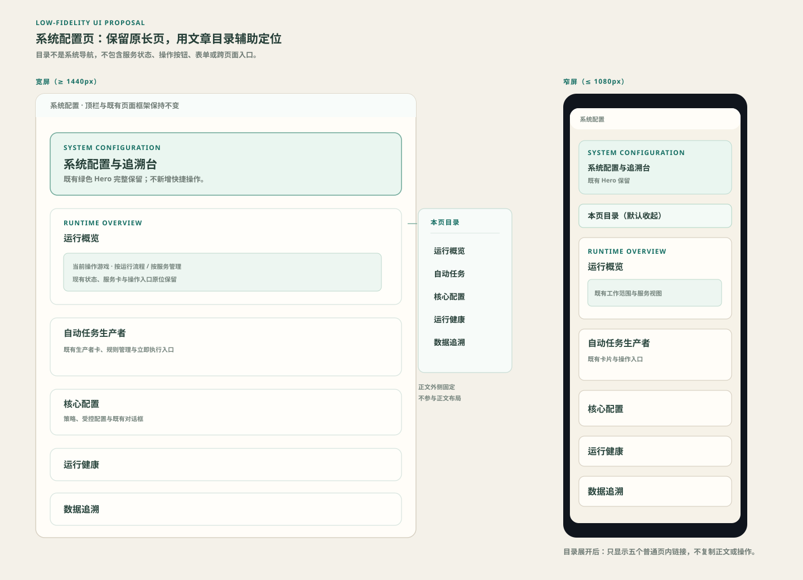
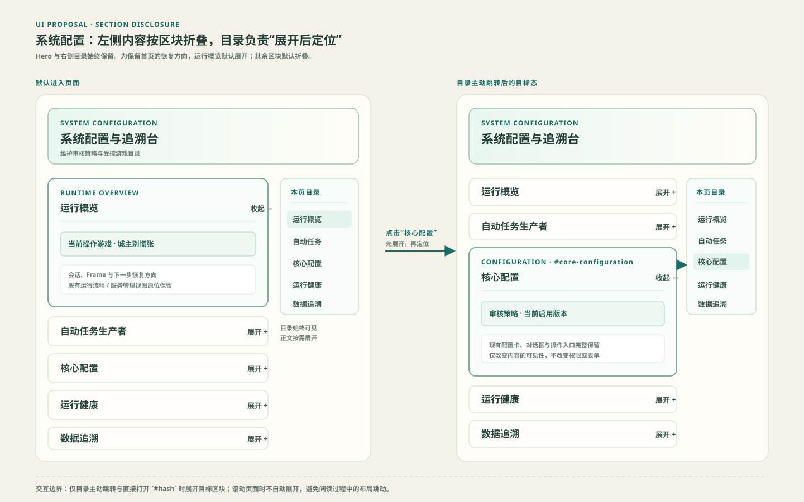

# 系统配置页 · 低保真 UI 方案

## 审批项

1. 宽屏将“本页目录”固定在正文右侧，Hero 与现有长页正文均保留。
2. 目录仅包含：运行概览、自动任务、核心配置、运行健康、数据追溯。
3. 目录不显示服务状态、按钮、表单、跨页面入口或诊断内容。
4. 窄屏在 Hero 后显示折叠的原生目录，正文维持单列。
5. 左侧正文以区块为单位可折叠：运行概览默认展开，其余四个区块默认收起；右侧目录点击或直接访问对应 hash 时，先展开目标区块再定位。滚动页面不会自动展开区块。

确认以上四项后，才进入实现；若需调整，先修改本方案图与 `design.md`。
